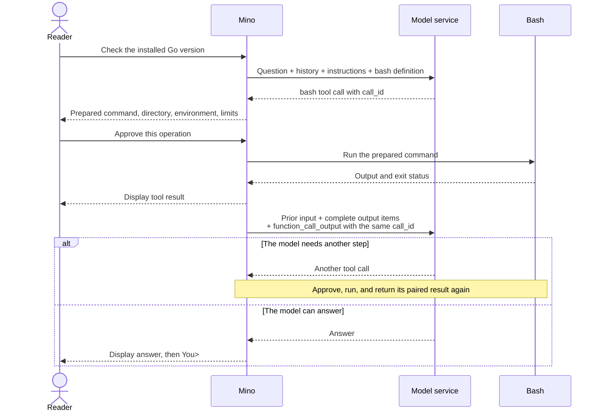
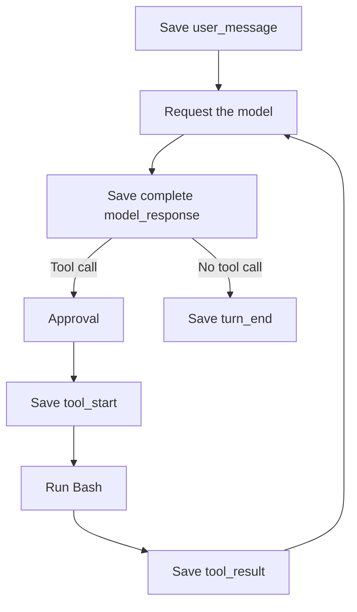

# Chapter 03: The first Agent loop with tools and Bash

Applies to **0.3.x** · Source and release tag **[chapter-03](https://github.com/qshine/mino/tree/chapter-03)** · Application version **0.3.0**, released **2026-10-21**

Ask Mino “Which Go version is installed on this computer?” Conversation history cannot supply a fact nobody has checked. This chapter gives Mino a way to obtain it: the model requests a Bash command, you approve the operation, and the program returns the result to the model.

Use the `chapter-03` release or its matching source checkout. Follow [setup and installation](../getting-started.md#try-chapter-03-from-source) before trying the interaction.

## 1. A question hands control back to you

Start Mino in the directory where you want commands to run. Ask it to check the installed Go version using `go version`. The model decides whether to request the tool; naming a command in an answer does not execute it.

Illustrative output, excerpt. The full approval screen also displays the resolved working directory, escaped environment, timeout, output limit, and account-permissions notice; those lines are omitted here. The version and model wording are examples, not live observations.

```text
You> Run go version and tell me which Go version is installed.

Assistant>
[Tool: bash]
Command: "go version"
Approve this operation? [y/N] y

[Tool result: completed; exit code 0]
go version go1.27.1 darwin/arm64

Assistant> This computer has Go 1.27.1 for macOS on Apple Silicon.

You>
```

The first model response can contain only a tool call, so an empty `Assistant>` is valid. Mino waits for your decision, runs the approved command, displays its result, and sends that result back. The model can then answer or request another tool. This repeated handoff is the *Agent loop*. One user turn now spans the original input, intermediate tool steps, and final answer.

Try the same question and enter `n`, or just press Enter, at the approval prompt. Mino does not run that command. It supplies a result with status `denied`, allowing the model to explain that it could not check. The denial is program behavior; whether the model explains it well is a separate question.

## 2. The Agent loop

Section 1 showed the loop from your side of the terminal. This section follows the same exchange from the model's side: what each request contains, what comes back, and what decides whether Mino asks again.

### 2.1 From tool call to paired result

Each request supplies the current question, replayable history, loaded instructions, and a `tools` definition for `bash`. That definition has one required string field, `command`, and allows no other fields. The model cannot run anything itself; it can only return a structured request. For the opening question, the response can contain a `bash` tool call with the arguments `{"command":"go version"}` and an identifier in `call_id`.

After the command runs, or is denied, Mino sends a `function_call_output` with that same `call_id`. Its JSON result carries a status, the captured output, and an optional exit code or truncation flag. A missing or duplicate ID invalidates the response, and reusing an ID from earlier in the same turn stops that response before any of its calls execute. **The `call_id` is what pairs each result with the request that caused it.**

The next request repeats the earlier input, then adds the model's complete output items in their original order, followed by the paired result. Those items include the assistant `phase` and opaque encrypted reasoning when present. Mino keeps `store: false` and requests `reasoning.encrypted_content`, so it supplies the context itself instead of linking requests through `previous_response_id`.



Figure 03-1. Each tool call returns to the model as a paired result; the model then decides whether to answer or ask again.

On narrow screens, scroll the diagram horizontally. The model service only sees the request and the result Mino sends back; it does not execute the local command.

### 2.2 Limits on one turn

Mino requests `parallel_tool_calls: false` and processes any returned batch sequentially. A turn permits at most 8 model requests and 16 tool calls. If the eighth response still asks for tools, or a new batch would exceed the call limit, Mino records the unstarted calls as `not_executed` and stops the turn as failed. It does not execute a batch when there would be no room for the next model request.

### 2.3 Who does what

The terminal side of Mino is the *command-line interface (CLI) Gateway*. It accepts input, displays events, and asks for confirmation; it does not open session files or execute Bash. The Agent sends model requests, consumes the response stream, and runs the tool loop, sending text, results, and notices back as events. Mino hands the Agent its session and tools when constructing it, so a different tool or interaction surface could reuse the same loop; this release still has only the CLI, one conversation, and Bash.

The exchange is synchronous. The CLI waits for the whole turn, including approvals, before accepting another question. A concurrent attempt to use the same session is rejected as busy before its input is written, so turns cannot interleave.

A tool takes part in three steps: describe the operation (`Definition`), validate the arguments and prepare display fields without executing anything (`Prepare`), then perform the prepared operation (`Execute`). Approval sits between the last two. You review what preparation produced; the Gateway receives only a copy of the display fields, while the Agent keeps the prepared arguments it will execute. That way the operation you approve is the operation that runs.

## 3. Approval covers one bounded execution

Preparation comes first. Bash checks the arguments locally as well as through the schema, rejecting empty commands, duplicate or unknown fields, invalid text, NUL characters, and commands over 16 KiB. A call that fails this check, or names a tool Mino does not have, never reaches the approval prompt; the model receives an `invalid_arguments` or `unknown_tool` result instead.

Before asking `Approve this operation? [y/N]`, the Gateway shows the prepared command, resolved startup directory, and environment with special characters escaped. You approve what those fields describe. Only `y` or `yes` approves, ignoring case and surrounding spaces. Each call needs its own decision; piped input cannot approve commands. Chat and approval share one input stream, so your confirmation is consumed as a decision rather than becoming the next question.

Mino starts `/bin/bash --noprofile --norc -c` with the approved command. Each invocation starts in the captured directory with a minimal environment, so a `cd` in one command does not change the next invocation's starting directory. Shell profiles and inherited startup variables do not run. The configured API key is not placed in the child environment; the exact environment is documented in [the source setup notes](../getting-started.md#try-chapter-03-from-source).

Standard output and standard error share a 64 KiB capture limit. After execution stops, Mino displays the captured result and passes it to the model. A nonzero exit code becomes a failed tool result, so the model can reason about the failure. A 30-second timeout or output overflow terminates the process group; overflow also marks the result as truncated. Ctrl+C cancels and exits, stopping the active process group. Already completed file or network changes are not undone.

These limits make execution bounded, but Bash still runs with your account permissions. It can read files or contact services available to that account, including through commands that change directories or set their own environment. Cleanup covers the process group; a descendant that detaches from it can escape. Mino bounds the wait for inherited output pipes to 250 ms and offers no background-job management or operating-system sandbox. Tool output is treated as untrusted data in the instructions; that guidance does not enforce a filesystem or network boundary.

## 4. Save every step before taking the next

Running a command introduces a problem that text-only history did not have: a turn can now leave a real effect behind. Mino keeps the same single conversation file as Chapter 02, `~/.mino/sessions/<session_id>.jsonl`, and records each tool step in it before moving on.

### 4.1 Save points in one turn

Every record below is written and synced before Mino updates the conversation state in memory, and before it takes the next step.



Figure 03-2. Each arrow out of a save point depends on that save succeeding; a denied call is saved as its result without a start.

Your input is saved before the first model request. Text fragments still appear as they arrive, but they are display events, not committed conversation state. Only a successful `response.completed` event lets the Agent validate the complete output and save it as a `model_response`. This applies to intermediate responses containing tool calls too. An argument fragment or a finished individual output item cannot start Bash; a dropped stream leaves no completed response to act on.

After approval, the Agent saves `tool_start` before execution, then saves `tool_result` before another model request. A final response without tool calls allows a completed `turn_end`. These records share the turn's `turn_id`; each tool's start and result also carry its `call_id`. A failed write or sync leaves the previously committed state unchanged and stops chat.

Saving only after execution would reduce writes, but leave no durable indication that a command might have started. Mino chooses the extra storage boundaries and stops chat if writing or syncing fails. The cost is interrupted work even when the command itself could run. The benefit is a recorded boundary, not a transaction spanning the filesystem and Bash: a saved start does not prove process creation, and a failed result write does not prove the command failed.

### 4.2 What a restart leaves out

On restart, Mino restores the file without executing tools or requesting the model. If the last turn stopped partway through a tool step, Mino closes it on disk: a call without a start record receives `not_executed`, a call with a start but no result receives `unknown`, and the turn ends as `interrupted`. Nothing is rerun. Before the banner, Mino prints:

```text
An interrupted tool turn was retained but excluded from context. Commands it started may already have run; none was retried.
```

That notice is for you. The model receives nothing from the turn, because Chapter 03 replays only completed turns, the same rule as Chapter 02. A tool turn that failed or was cancelled while Mino was running, such as one stopped by the limits in [Section 2.2](#_2-2-limits-on-one-turn), is likewise kept in the file but left out of later requests.

Excluding the turn keeps replay simple and never presents partial text as an answer. **The cost is that the model is not told that a command may already have run.** If you ask again, the model sees no trace of the earlier attempt and may request the same command. Your approval is then the only thing standing between it and a repeated effect.

## 5. Check execution and replay separately

A model saying “Go 1.27.1” cannot prove that Bash ran. From the repository root at `chapter-03`, check the execution and replay boundaries:

```bash
go test ./internal/agent ./internal/gateway ./internal/tools
```

These tests use temporary home and working directories and local mock HTTP services, with no real API key or paid model requests. A successful run prints `ok` for all three package paths. The mock service needs permission to bind a local port.

One contract test injects a test-only `echo` tool without changing the Agent loop. It checks the disk records at each save point in Figure 03-2: input before the first model request, complete response before confirmation, start before execution, and result before the next request. Its successful result has no process exit code, demonstrating that the shared result format does not require every tool to run a process. Bash still records its exit code when available; `echo` is not included in the running application.

Separate tests inject a sync failure and verify that the in-memory state does not advance, and submit a concurrent question to verify that a busy turn is rejected before writing. Approval tests check default refusal and shared input. Protocol tests inspect paired IDs and retained response items, while incomplete responses and invalid calls must never execute. Bash tests cover failed exit status, environment isolation, timeout, output overflow, cancellation, and ordinary background-child cleanup.

The Bash integration case writes and reads a known marker in a temporary directory, checks the result sent to the model, then reopens the conversation and verifies that a follow-up does not execute the old command. The [interrupted-turn test](https://github.com/qshine/mino/blob/chapter-03/internal/agent/history_tools_test.go) stops a turn after the response, after a tool start, and after a saved result. After reopening, each file contains the recovered `not_executed` result, `unknown` appears only when a start lacked its result, and the replayed context is empty in every case. That last check is the limit from Section 4.2, made repeatable.

These checks establish the tested control flow and replay contents. They do not prove live answer quality, compatibility with every Responses endpoint, or containment of processes that escape the group. The opening Go-version interaction remains service-dependent; the mock tests provide repeatable evidence.

## 6. Chapter outcome and next step

The Go-version question now has a path to evidence: a complete tool call, your approval, a bounded Bash execution, and a paired result supplied to the model. Every step reaches disk before the next one starts, so a crash never causes Mino to rerun a command.

What a crash still hides is the evidence itself: the file knows a command may have run, but the model does not. [Chapter 04](../plan-todo-chapters.md), available in the `chapter-04` release, replays interrupted tool turns with their paired results and asks you to acknowledge unknown outcomes before the conversation continues.
