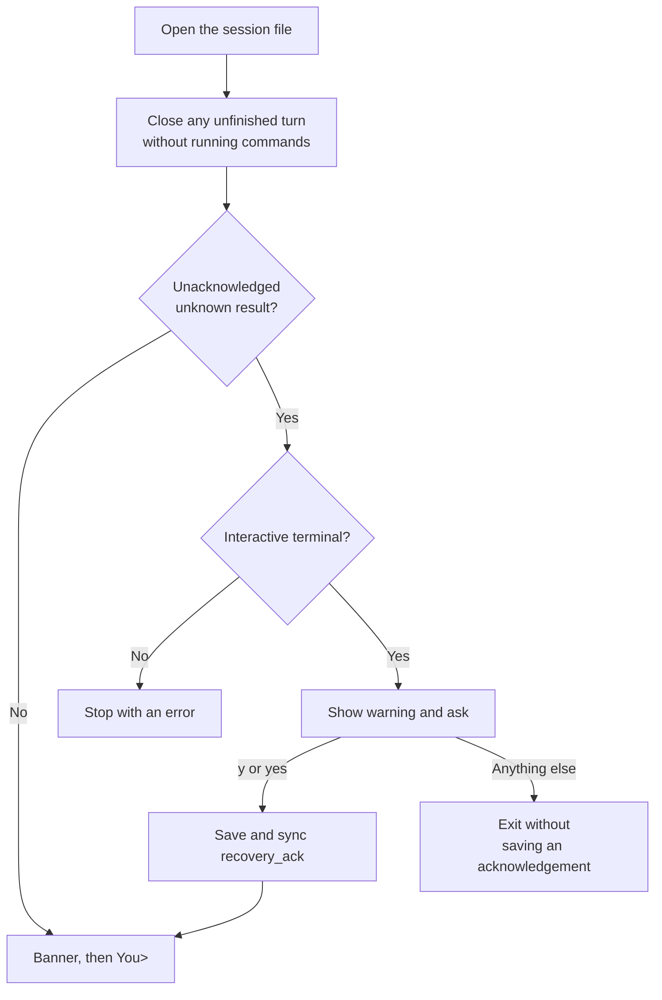

# Chapter 04: Recover interrupted tool turns honestly

Applies to **0.4.x** · Source and release tag **[chapter-04](https://github.com/qshine/mino/tree/chapter-04)** · Application version **0.4.0**, released **2026-10-21**

Ask Mino to add “milk” to your shopping list, approve the command, and then lose the process before its result is saved. In [Chapter 03](./03-tools-and-bash.md), the restarted Mino never reruns the command, but it also never tells the model about the attempt. The file knows milk may already be on the list; the model does not.

This chapter keeps the same records and changes what Mino does with them. An interrupted tool turn returns to the model with its paired results and a runtime notice, and an `unknown` result must be acknowledged by you before the conversation continues. Use the [Chapter 04 source setup](../getting-started.md#try-chapter-04-from-source) to follow along.

## 1. A command whose result was never saved

Start from an ordinary tool turn. The model requests an append, and you approve it.

Illustrative output, excerpt. The approval screen's directory, environment, and limit lines are omitted.

```text
You> Add milk to shopping.txt.

Assistant>
[Tool: bash]
Command: "echo milk >> shopping.txt"
Approve this operation? [y/N] y
```

Mino saves `tool_start` and runs the command. Now suppose Mino stops before the `tool_result` record reaches the file: the disk is full when the result is written, or the process is killed. The append may have happened. Nothing in the file says whether it did.

Restart the `chapter-03` release, and Mino prints a notice for you but supplies none of that turn to the model. Ask “Add milk to shopping.txt” again, and the model has no reason to know an earlier attempt exists; if it requests the same append and you approve it, the list holds milk twice. Restart the `chapter-04` release instead, and the first thing you see is a question.

Illustrative output.

```text
An interrupted tool turn was recovered without executing commands.
A previous command started, but its result is unknown. It may have changed files or external systems. Mino has not rerun it. Review those effects before continuing.
Do you understand that these commands may already have run? [y/N] y
Mino - Chapter 04: Recovering Tool Turns
History is restored on startup. Bash commands require approval. Use /exit, Ctrl+D, or Ctrl+C to quit.

You> Is milk on the list now?

Assistant> The earlier append may have run, but its result was not saved. I can read shopping.txt to check, if you approve.
```

The answer is model wording and will vary. What is fixed is that the model received the interrupted call, its `unknown` result, and Mino's notice before your question. The next three sections explain those three pieces.

## 2. What the saved records establish

Recovery still uses the save points from [Chapter 03](./03-tools-and-bash.md#_4-1-save-points-in-one-turn): `tool_start` is synced before Bash runs, and `tool_result` before the next model request. On restart, Mino closes every unresolved call in an unfinished turn according to the records it finds, then ends the turn as `interrupted`. It never executes anything to find out more.

Table 04-1. Each recovered result states only what the saved records establish.

| Saved evidence | Recovery result | What you can conclude |
| --- | --- | --- |
| Call without a start | `not_executed` | Mino did not reach the recorded execution boundary. |
| Start without a result | `unknown` | The operation may have happened; the result is unavailable. |
| Call with a result | Retain that result | The recorded outcome can enter later context without another execution. |

The milk command lands in the middle row. A saved start does not prove that the process was created, and a missing result does not prove that the command failed. `unknown` is the only honest name for that state. Chapter 03 already wrote these results to disk; what changes here is who gets to see them.

## 3. Replay the interrupted turn with its results

A failed, cancelled, or interrupted turn that contains tool calls now enters later context. That covers the crash above, a turn stopped by the 8-request or 16-call limit, and a turn cancelled during a command.

### 3.1 What the next request contains

After the restart, your question about milk arrives with the recovered turn in front of it. The excerpt below is simplified: it shows the order and content of the input items, with reasoning items and some fields omitted. `call_1` stands for the identifier the model returned.

```json
[
  {"role": "user", "content": "Add milk to shopping.txt."},
  {"type": "function_call", "call_id": "call_1", "name": "bash", "arguments": "{\"command\":\"echo milk >> shopping.txt\"}"},
  {"type": "function_call_output", "call_id": "call_1", "output": "{\"status\":\"unknown\",\"output\":\"Execution was started but its result was not saved. The operation may have happened. Do not automatically retry it.\"}"},
  {"role": "assistant", "content": "Mino runtime notice: the previous turn ended with status interrupted. Tool results above are retained; no command was automatically retried."},
  {"role": "user", "content": "Is milk on the list now?"}
]
```

The call and its result keep their shared `call_id`, exactly as in a completed turn. The notice comes from Mino, not the model; it is labeled as a runtime notice and records the turn's ending status. These items stay in the conversation's context for every later request, not just the next one.

A turn that ends early without any tool calls is still excluded. It has no tool effects to report, and its partial streamed text must not look like a final answer.

The default instructions in `SOUL.md` extend one line to match: a refused, failed, cancelled, or unknown result is not success, and an unknown operation must never be retried automatically. Like any instruction, this guides the model; it does not enforce anything.

### 3.2 Why replay instead of hiding or retrying

Two simpler options exist. Chapter 03 hides the turn, which kept replay simple but left the model unaware of a possible effect. Mino could also rerun the command, but for an append that is exactly the duplicate you are trying to avoid, and Mino cannot tell which commands are safe to repeat.

Mino currently replays the recorded pairs with an explicit notice. The cost is that context now includes a turn with no final answer, and the model must interpret a result that says “maybe.” Whether it does so well is model-dependent. What the program guarantees is narrower: the model receives the evidence, and nothing runs again without a new approval from you.

## 4. Acknowledge an unknown result

Telling the model is not enough on its own. The model cannot open `shopping.txt` without asking you, and only you can check effects outside the computer, such as a message that may have been sent. Mino currently adds a second step for `unknown`: it stops at startup until you acknowledge the result.

### 4.1 The startup gate



Figure 04-1. Only an `unknown` result triggers the question, and only a saved acknowledgement clears it.

The question appears before the banner, so there is no `You>` prompt until it is answered. As with command approval, only `y` or `yes` counts. Mino then appends one `recovery_ack` record for each turn that contained an unknown result and syncs it before chat begins.

Any other answer, including just pressing Enter, exits Mino without saving an acknowledgement. The recovered results are already on disk, but the next start asks again, and so does every start after that until an acknowledgement is saved. Redirected or piped input cannot acknowledge; Mino stops with `Unknown tool results require acknowledgement in an interactive terminal`.

The terminal's gate is not the only check. While an unknown result is unacknowledged, the Agent itself refuses a new question with `Acknowledge unknown tool results before continuing`, so another interaction surface could not skip the step by never asking.

`not_executed` results do not trigger the question. A call that never started cannot have changed anything, so the replay and the startup notice are enough.

### 4.2 What acknowledgement does and does not mean

A `recovery_ack` record says that you confirmed you understand the command may have run. That is all.

It does not rerun the command, check the file, or change the result. The model still sees `unknown` in later requests. If you want to know whether milk is on the list, look at `shopping.txt` yourself, or let the model request a read and approve it.

The cost of this design is an interruption you cannot configure away: Mino stops even for an unknown `go version`, because it cannot distinguish a harmless command from a harmful one. A saved start record is enough to trigger the gate, even if the process was never created.

## 5. Open a Chapter 03 session

Chapter 04 writes the same `v: 2` records into the same session file and adds one record kind, `recovery_ack`. It reads files written by `chapter-03` as they are, with two visible consequences. Tool turns that Chapter 03 excluded now enter context with their notices. An `unknown` result left by Chapter 03, which never asked for acknowledgement, triggers the startup question.

The reverse direction stops working once you acknowledge. `chapter-03` does not know the `recovery_ack` record kind and refuses to open the file. See the [Chapter 04 source setup](../getting-started.md#try-chapter-04-from-source) for backup steps before switching releases.

## 6. Check recovery with mock tests

A sensible answer about milk proves neither replay nor the gate; a model could guess. From the repository root at `chapter-04`, run the two recovery tests:

```bash
go test ./internal/agent -run 'TestToolHistoryRecoveryPreservesPairsAndAcknowledgement|TestUnknownResultGatesChatUntilAcknowledged' -v
```

They use temporary home directories and saved records instead of a model service, so no API key is needed. Both test names should report `PASS`, followed by `ok` for the package.

The [first test](https://github.com/qshine/mino/blob/chapter-04/internal/agent/history_tools_test.go) stops a two-call turn after the response, after the first tool start, and after the first saved result, then reopens the file. In every case six items return to context: your input, both calls, both results, and the runtime notice. The acknowledgement requirement appears only when a start lacked its result; that state survives another reopen, and a saved `recovery_ack` clears it for good.

The second test saves the situation from section 1, a start without a result, and reopens it. It checks that the replayed input contains the call's ID, the `unknown` result, and the notice. A question before acknowledgement is refused. Declining ends startup, and accepting afterwards leaves exactly one `recovery_ack` in the file.

These tests establish what context is rebuilt and when the gate opens. They do not simulate a real crash or a full disk, run the terminal's interactive-input check, or show how a model reasons about `unknown`.

## 7. Chapter outcome and next step

The milk command no longer disappears from the conversation. After a crash, the model receives the call, its honest `unknown` result, and Mino's notice, and you confirm that you know the command may have run before anything else happens. Nothing is retried; deciding what to do about the possible effect is still up to you and a new, approved tool call.

All of this still happens inside one conversation file. [Chapter 05](../plan-todo-chapters.md), available in the `chapter-05` release, lets you start a new session for an unrelated task while an earlier one, along with its recovered tool turns, stays available to resume.
