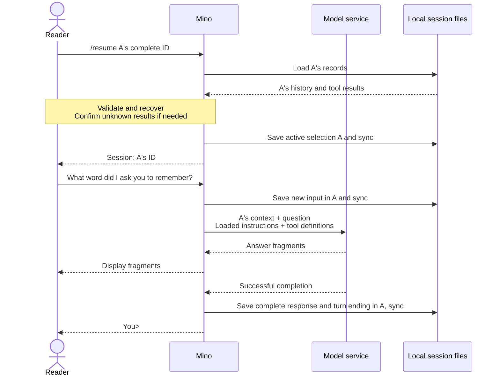

# Chapter 05: Managing multiple conversations with JSONL sessions

Applies to **0.5.x** · Source and release tag **[chapter-05](https://github.com/qshine/mino/tree/chapter-05)** · Application version **0.5.0**, released **2026-10-21**

Tell Mino to remember the word “pine,” then start an unrelated task. Up to Chapter 04, `~/.mino/sessions/` holds exactly one conversation, so starting fresh means moving that file aside. You need a way to leave the word task without deleting it, and return when its earlier context matters again. This chapter lets that directory hold several sessions and lets you choose which history accompanies the next question.

Use the [Chapter 05 source setup](../getting-started.md#try-chapter-05-from-source). The examples below illustrate the interaction; model answers are not live observations.

## 1. Ask the same question in two sessions

At `You>`, enter `/new` to create a session for the word task. Note the ID Mino prints. After one exchange, use `/new` again to start another session, then return to the first with `/resume`.

Illustrative output, excerpt. The repeated `a` and `b` IDs stand for generated IDs; use the complete IDs printed by your own Mino.

```text
You> /new
Session: aaaaaaaaaaaaaaaaaaaaaaaaaaaaaaaa

You> Remember the word pine.
Assistant> The word is pine.

You> /new
Session: bbbbbbbbbbbbbbbbbbbbbbbbbbbbbbbb

You> What word did I ask you to remember?
Assistant> You have not given me a word in this conversation.

You> /resume aaaaaaaaaaaaaaaaaaaaaaaaaaaaaaaa
Session: aaaaaaaaaaaaaaaaaaaaaaaaaaaaaaaa

You> What word did I ask you to remember?
Assistant> You asked me to remember pine.
```

Call the first session A and the second B. B's request does not contain A's word exchange. After you resume A, that exchange becomes available to the model again. The request contents are deterministic; the model's wording, including whether it admits missing information in B, is not.

Use `/sessions` to find an earlier ID. Mino lists session IDs and file modification times in Coordinated Universal Time (UTC), most recently updated first, with `*` beside the current session. It does not generate titles from your messages. `/resume` accepts only a complete ID of 32 lowercase hexadecimal characters naming an existing session; shortened IDs and paths are rejected. `/help` lists the commands.

These commands belong to [Mino's input handling](https://github.com/qshine/mino/blob/chapter-05/internal/agent/session_commands.go). They are not saved as user messages or sent to the model. An unknown slash command produces an error instead of becoming a model question. Enter commands at the next `You>` prompt: Mino finishes the current turn, including tool approvals, before handling another line. Text such as `/new` inside a model answer or tool result is just text.

## 2. Select the history before sending a question

Since Chapter 02, the conversation has lived in `~/.mino/sessions/<session_id>.jsonl`, named by its ID. This chapter only lets the directory hold more than one such file. The filename identifies the conversation, so individual records still have no `session_id` field. Each file has its own consecutive `seq` values and turns paired by `turn_id`; tool calls and results retain their `call_id` values. The existing rules determine which records can be replayed as context.

One alternative would keep every conversation in a shared log and filter records by session ID. Mino instead keeps a file per session. Selecting A means loading A's history; a new file starts without earlier exchanges. The tradeoff is an additional responsibility: Mino must durably remember which file you selected. It [saves that choice separately](https://github.com/qshine/mino/blob/chapter-05/internal/agent/sessions.go) in `active-session.json`, and reports the new session only after saving succeeds.

The next question uses the selected session's replayable history, the new input, the loaded instructions, and the available tool definitions. Merely creating or resuming a session sends no model request. Mino continues to supply context explicitly with `store: false`; it does not ask the service to remember which local session is active.



Figure 05-1. Selection is local; A's history reaches the model only with the next question. This example shows a response without a new tool call.

On narrow screens, scroll the diagram horizontally.

## 3. Return to the last session after restarting

When you start Mino again, it reads `active-session.json` and restores that session, printing its ID without replaying the old terminal display. Table 05-1 shows what happens when that file is absent or unusable.

Table 05-1. What startup selects

| Store at startup | Mino's action |
| --- | --- |
| No session files | Creates an empty session and selects it |
| `active-session.json` names a loadable session | Restores that session |
| No `active-session.json`, exactly one session file | Selects that file in place and saves the selection |
| No `active-session.json` with several session files, a damaged selection, or a selected log that cannot be loaded | Reports the problem and accepts only commands |

The third row is the upgrade path. Chapters 02–04 leave one conversation in the same directory with no selection file. Mino selects it where it is: the file is not copied, renamed, or rewritten, and only `active-session.json` is added. Because Chapter 02 already named that file by its ID, a single conversation is already a valid session.

The last row reflects a deliberate refusal to guess. With several sessions and no saved choice, picking the newest file could send the wrong conversation's history with your next question. Mino prints `Cannot restore the active session: ...` and rejects ordinary questions until you choose: use `/sessions` followed by `/resume <id>`, or `/new`. It does not silently replace a missing or damaged selection with an empty conversation, and a valid ID whose log cannot be loaded does not replace the current selection.

Restoring or resuming a session also applies [Chapter 04's recovery rules](./04-recovering-tool-turns.md). Mino never executes historical commands. Before activating a session with an unacknowledged unknown result, it asks whether you understand that the command may already have run, and saves your acknowledgment. Declining exits the CLI; during `/resume`, it also leaves the previous selection unchanged. Even a declined attempt may have added recovery records to the target log; keeping the selection unchanged does not mean the target file was untouched.

## 4. Clear A while keeping its identity

Sometimes you want to discard a session's context without creating another ID. `/clear` asks you to type the current session's complete ID in an interactive terminal. A blank answer, `yes`, or a different ID denies the operation; surrounding whitespace is ignored, but the ID's case must match. Piped input cannot approve clearing.

Illustrative output, after returning to A:

```text
You> /clear

Session: aaaaaaaaaaaaaaaaaaaaaaaaaaaaaaaa
Clear this session's saved history? This does not undo executed commands or delete recovery copies or manual backups.
Type the complete session ID to clear it: yes
Session was not cleared.
```

After this denial, A's history remains available. If you repeat `/clear` and enter A's exact ID, Mino confirms `Cleared session: aaaaaaaaaaaaaaaaaaaaaaaaaaaaaaaa`. It replaces A's log with an empty file, then resets its in-memory history. The ID stays the same, B is unchanged, and the next question has no earlier A exchanges.

Mino prepares and syncs the empty file before replacing the old log, then syncs the directory before reporting success. A failure stops chat without claiming that clearing succeeded.

## 5. Know what a session does not separate

Sessions separate conversation context and nothing else. These boundaries apply to every command above:

- **Environment.** `/new` and `/resume` keep the SOUL loaded at startup, the configured model service, and the Bash working directory captured for this run. Resuming a conversation from another directory does not restore its former working directory; each tool approval shows the actual directory.
- **Processes.** Mino holds the store-wide `sessions.lock` from startup until exit, so creating, selecting, and clearing cannot compete across Mino processes. The cost is that a second process cannot use even a different session at the same time.
- **Storage failures.** When saving a selection or a cleared log fails, Mino stops chat: the disk may no longer match the in-memory state, so continuing from that state would be unsafe. Stopping does not undo what was already displayed or done.
- **Clearing.** `/clear` is a persistence boundary, not secure erasure. It does not undo Bash effects or delete recovery copies and your backups.

## 6. Check the requests and selection

To check A → B → A without a live model, run these tests from the repository root at `chapter-05`:

```bash
go test ./internal/agent ./internal/gateway -run 'TestSession|TestResume|TestClear'
```

The tests use temporary directories and a local mock HTTP service. They do not read your real configuration or history and require no paid model calls. A passing run shows `ok` for both packages; the mock service needs permission to bind a local port.

The [request test](https://github.com/qshine/mino/blob/chapter-05/internal/agent/session_commands_test.go) submits “Remember pine.” in A, creates B, and asks “What word?” It checks that B's first request contains only that question. After resuming A, the same question follows A's earlier exchange. Listing, help, and selection commands add no model requests. Denied clearing keeps the history, while approved clearing leaves the next request with only its new input and preserves the other session.

The [upgrade test](https://github.com/qshine/mino/blob/chapter-05/internal/agent/sessions_test.go) saves one completed exchange the way Chapters 02–04 do, with no selection file, then opens the multi-session store. It checks that the pointer names that same file, no selection notice appears, the history is loaded, the file's bytes are unchanged, and no second session file exists. With two sessions and a missing or damaged pointer, the same suite expects command-only recovery instead.

Additional cases check restart selection, invalid IDs, unsafe files, and a second process competing for the store lock. A resumed tool call keeps its paired result, requires acknowledgment when unknown, and executes zero times. Simulated rename and directory-sync failures must prevent further chat.

These checks establish the tested request contents and control flow. They do not prove that a live model will answer “pine,” cover every disk failure, or show that clearing erases all copies of private data. If you try the opening interaction yourself, use the displayed IDs to track the selection; judge isolation by the supplied context, not by a plausible answer alone.

## 7. Chapter outcome and next step

You can now leave the word task, start a separate conversation, and return with its earlier history intact. Mino persists the selection, picks up the conversation an earlier chapter left behind without copying it, and lets you clear one session after explicit confirmation.

Each selected conversation still supplies all of its replayable history. A long session can outgrow the model's context limit even when other sessions are isolated. [Chapter 06](../plan-todo-chapters.md), available in the `chapter-06` release, combines manual `/compact` with automatic budget checks. It summarizes older exchanges while retaining recent detail, using a configurable context window with a default of 128,000 tokens.
