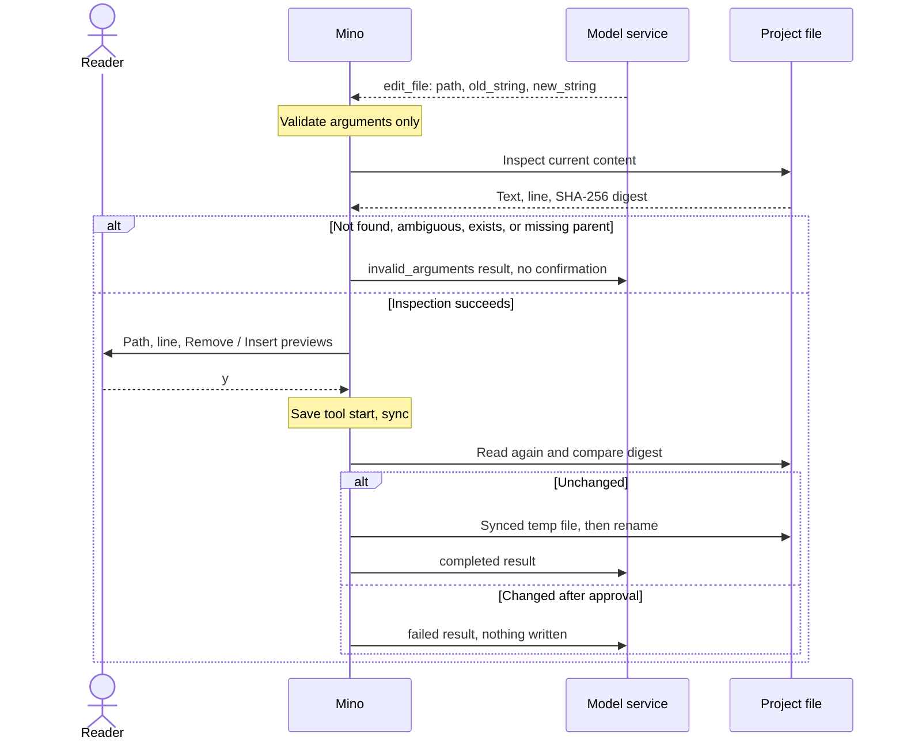

# Chapter 07: Read and write project files with file tools

Applies to **0.7.x** · Source and release tag **[chapter-07](https://github.com/qshine/mino/tree/chapter-07)** · Application version **0.7.0**, released **2026-10-11**

You ask Mino to change one constant in `greet.go` from `"hi"` to `"hello"`. In [Chapter 06](./06-skills.md), the only way to touch that file was Bash: the model would propose something like a `sed` command, and the approval screen would show a command string you had to decode yourself. The program could not tell which files that string would touch.

This chapter adds three structured tools: `read_file`, `write_file`, and `edit_file`. Each names one path the program can check before acting. Reads stay inside the project and need no approval; every write or edit shows you exactly what will change and runs only after you approve it. To try it, follow [the Chapter 07 setup notes](../getting-started.md#try-chapter-07-from-source).

## 1. A small change in two tool calls

Start Mino in the project directory that contains `greet.go`, then ask for the change.

Illustrative output, with observed tool lines. The question and the final answer are examples; the `read_file` result, the confirmation block, and the edit result match a local smoke run against a mock model service, with the project path replaced by `/path/to/project`.

```text
You> Change the greeting in greet.go to "hello".

Assistant>
[Tool result: completed]
package main

const greeting = "hi"


Assistant>
[Tool: edit_file]
Path: "greet.go"
Project directory: "/path/to/project"
Starting line: "3"
Remove: "\"hi\""
Insert: "\"hello\""
Resulting file: "39 bytes, 3 lines"
Writes with your account permissions; approval applies only to this change to the current file.
Approve this operation? [y/N] y

[Tool result: completed]
Edited greet.go at line 3 (39 bytes, 3 lines).

Assistant> I changed greeting from "hi" to "hello" on line 3 of greet.go.

You>
```

The turn contains two handoffs. First, the model returns a `read_file` call with `{"path":"greet.go"}`. Mino reads the file and sends its text back as a paired tool result, without asking you: like `skill_view`, this read is confined in code, so the program marks it read-only. Mino still displays the result, so you can see what the model received.

Second, the model returns an `edit_file` call with `path`, `old_string`, and `new_string`. Now control passes to you. The confirmation shows which text will be removed and inserted, where it starts, and the size of the resulting file. Pressing Enter or typing `n` denies it: the file stays unchanged, and the model receives a `denied` result. After `y`, Mino writes the change and sends the result back; the model can then answer or request another tool.

The tools differ in what they ask for and what must already be true.

Table 07-1. Each file tool has explicit arguments and preconditions; only reads skip approval.

| Tool | Arguments | Approval | Must be true before acting |
| --- | --- | --- | --- |
| `read_file` | `path` | None | A regular UTF-8 text file of at most 64 KiB inside the project |
| `write_file` | `path`, `content`, `mode` | Each call, default deny | `create`: target absent, parent directory exists. `overwrite`: existing regular file, whose permissions are kept |
| `edit_file` | `path`, `old_string`, `new_string` | Each call, default deny | `old_string` is non-empty, differs from `new_string`, and occurs exactly once |

There is no “create or overwrite, whichever applies” mode. The model must say which one it means, and the confirmation states it: `Create a new file`, or `Overwrite the existing file (N bytes)`. A write confirmation previews the new content; an edit previews the removed and inserted fragments. Previews show at most 20 lines and 2 KiB, followed by a count of the bytes not shown, and the byte and line totals are always included.

## 2. Inspect before asking, recheck before writing

A confirmation is only useful if it describes the file as it is now. Mino therefore reads the target before asking you, and checks it again after you answer.



Figure 07-1. Inspection happens only for a live call, before you are asked; approval covers the content you saw, and the recheck refuses anything else.

Scroll the diagram horizontally on narrow screens. Every result, including `invalid_arguments`, is saved and displayed as an ordinary paired tool result before the next request.

### 2.1 Why inspection is a separate step

Every tool already has a validation step that checks the model's arguments. It would seem simpler to read the file there and build the confirmation at the same time. Mino cannot, because of [Chapter 03's replay rules](./03-tools-and-bash.md): when a session is loaded, the history check runs that same validation on every recorded tool start to confirm the saved arguments are still well formed.

If validation read the file, a session would depend on the current filesystem. After you edit `greet.go` again, or delete it, an older turn that edited it could fail the check and make the whole session unreadable. Mino currently chooses to keep validation purely about arguments and to add a **live-only inspection** between validation and approval. Inspection reads the file, builds the confirmation, and records what it saw; replay never runs it.

The cost is a second step every file-writing tool must implement correctly, and a short window between inspection and writing in which the file can still change. That window is what the recheck covers.

### 2.2 Approval bound to what you saw

Inspection records a SHA-256 digest of the file it read, or notes that a `create` target was absent. After you approve, Mino reads the file again. If the content differs, nothing is written and the model receives `failed` with `File changed after approval; nothing was written.` For `create`, publishing refuses to replace a file that appeared in the meantime. Your approval never stretches to content you were not shown.

When inspection itself fails, there is nothing meaningful to approve. A missing file, an `old_string` that is absent or occurs more than once, an existing `create` target, or a missing parent directory returns `invalid_arguments` to the model with a short reason, such as asking it to read the file and copy the exact text. You are not interrupted.

An approved write goes to a temporary file in the same directory, which is synced first. `create` then hard-links it to the target name, which fails rather than replacing an existing file; `overwrite` and edits rename it over the target. The directory is synced last. Readers of the file therefore see either the old content or the new content, not a half-written mixture. As in Chapter 03, Mino saves the tool start before writing; if the process stops before the result is saved, the recovered result is `unknown` and is never written again automatically.

## 3. Boundaries a path can express

Paths are relative to the **project directory**: the directory where Mino started, the same one Bash uses. `/new` and `/resume` do not change it. Mino rejects absolute paths and `..` escapes, then opens files through Go's `os.Root`, which refuses symbolic links that lead outside the project. It also refuses a symbolic link as the final path element, special files such as FIFOs, files with more than one hard link (another name could point to a file elsewhere), text that is not UTF-8 or contains NUL, and files over 64 KiB.

Why build these tools before the guardrails chapter? Bash receives an arbitrary string, and no path rule can reliably say which files `sed`, a script, or a pipeline will touch. A structured call states its target, so the program can check it before acting and show you a precise confirmation. **The file tools give Chapter 09 something it can actually confine.** Bash itself is unchanged: each command still needs its own default-deny approval, and the file tools do not relax it.

Unapproved reads have a cost. Whatever `read_file` returns is sent to the configured model service and saved in the session log. This chapter makes no distinction between ordinary and sensitive files, so a `.env` file inside the project is as readable as `greet.go`. Protected paths are planned for [Chapter 09](../plan-todo-chapters.md).

One protection arrives now. If the project directory contains Mino's own data directory, `~/.mino`, the file tools are unavailable: each call returns an error result explaining why, and nothing is read or written. Starting Mino in your home directory is the common case. Without this check, an unapproved read could send your API key or other sessions' history to the model service.

These checks constrain the file tools only. They are not an operating-system sandbox; approved writes run with your account permissions. Each read, write, or edit counts toward the existing limit of 16 tool calls per turn, and returned file text counts toward the context budget and can later be summarized by compaction.

## 4. Check the approval flow with mock tests

From the repository root at `chapter-07`, run:

```bash
go test ./internal/tools -run 'File|Preview'
go test ./internal/agent -run FileTools
```

Both use temporary project and home directories; the second also uses a local mock Responses service. They need no API key and make no paid request, although the mock service needs permission to bind a local port. A passing run reports `ok` for each package.

The agent test follows this chapter's scenario. The mock model reads `greet.go`, which needs no confirmation, then requests the edit. The test approves it and checks the `Starting line`, `Remove`, and `Insert` fields, plus the edited file. A third call names an absent fragment and must fail as `invalid_arguments` without reaching confirmation. A fourth requests an overwrite that the test denies, and the file must stay unchanged. Finally, the test deletes `greet.go` and reopens the session: the saved turn must still load, which is the replay property from section 2.1.

The tools tests cover the boundaries: reads through symbolic links, hard links, FIFOs, oversized or non-UTF-8 files fail without leaking outside content; `create` and `overwrite` enforce their preconditions; a file changed after inspection, or a `create` target that appears, is left untouched; no temporary files remain; and the tools are disabled when the project contains Mino's data directory.

These tests establish program behavior: what needs approval, what the confirmation shows, and when nothing is written. They do not establish that a real model will choose `edit_file` over Bash or copy `old_string` correctly; that depends on the configured service.

## 5. Chapter outcome and next step

The greeting change now takes one confined read and one approved edit, and the confirmation describes the exact change to the file as it currently is. Mino refuses paths outside the project, rechecks the file after approval, and writes atomically. Reads still send any project file to the model service, and Bash remains a general escape hatch guarded only by approval.

Every tool so far is built into Mino. Planned [Chapter 08: Connect external tools with MCP](../plan-todo-chapters.md) brings tools hosted by remote services or local processes into the same Agent loop, with approval for each call.
