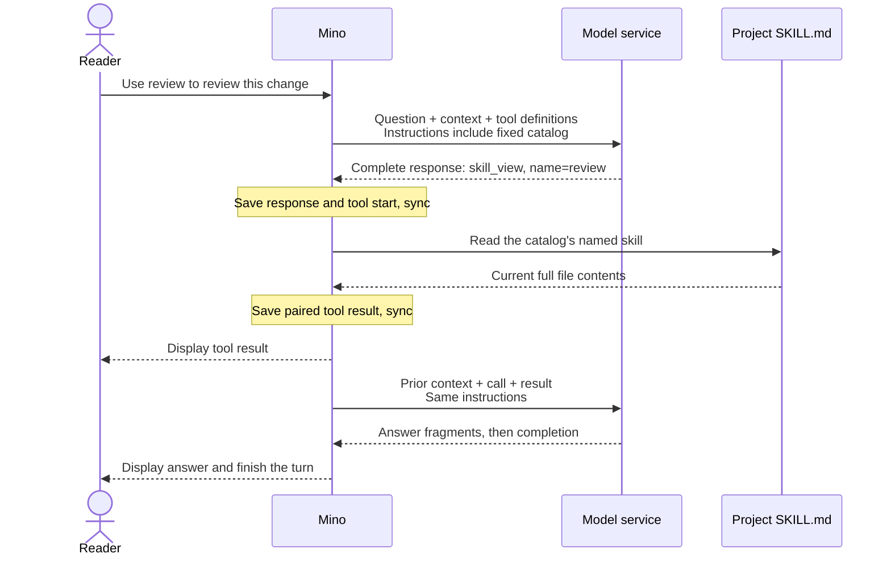

# Chapter 07: Skills for on-demand task knowledge

Applies to **0.7.x** · Source and release tag **[chapter-07](https://github.com/qshine/mino/tree/chapter-07)** · Application version **0.7.0**, released **2026-10-21**

You ask Mino to review a change. The conversation contains the code, but not your project's review method: check tests first, identify a concrete failure, and separate confirmed findings from uncertainty. A skill puts that reusable guidance in a file the model can request when it needs it.

Follow the [Chapter 07 source and skill setup](../getting-started.md#try-chapter-07-from-source). This chapter separates two inputs: a small, fixed directory of available skills and the full text of a selected skill.

## 1. Let the model select the guidance

Suppose the project contains a skill named `review`, described as “Review code changes using tests and concrete evidence.” You submit “Use the review skill to review this change,” followed by the change. Mino sends the skill's name and description in the request's `instructions`, alongside the loaded SOUL guidance. The skill body is absent from this discovery catalog.

If the model decides to use it, the model returns a `skill_view` tool call with arguments `{"name":"review"}`. Mino reads the named file and supplies its complete contents as a tool result. The model can then use those instructions to review the supplied change or request further evidence. **The model chooses the skill; Mino performs the read.** Merely mentioning a skill in an answer does not load it.

Illustrative interaction. The model's decision and eventual answer depend on the configured service.



Figure 07-1. Discovery metadata reaches the model before selection; the full skill enters the conversation through a paired tool result. Normal input and final-response persistence also apply.

Scroll the diagram horizontally on narrow screens. A successful read appears in the terminal under `[Tool result: completed]`; the model's next response may answer or request another tool. A skill is task guidance, not an executable plugin or a new tool definition.

## 2. Keep one catalog for the session

Mino discovers only direct `.agents/skills/<name>/SKILL.md` files under the project directory captured when the process starts. It reads the YAML `name` and `description`, sorts entries by name, and saves a `session_skills` snapshot in the session log. The snapshot includes that project location. Mino writes and syncs it before using it in model instructions, including when the catalog is empty.

Loading every skill body immediately would spend context on guidance unrelated to the question. Rescanning descriptions before every request would pick up edits quickly, but change the instructions during a conversation. Mino chooses **fixed discovery metadata with on-demand body reads** to keep this part of the prompt stable for the session and support reuse by a model service's prompt cache. Each normal request still sends the catalog; “load once” refers to filesystem discovery, not one-time transmission.

The cost is deliberate staleness: changing a description or adding a skill does not update an existing session. A stable catalog also does not guarantee a cache hit or a lower bill. Mino does not measure cache hits, and other request contents and service behavior still matter.

Table 07-1. Session operations preserve or replace discovery metadata at explicit boundaries.

| Action | Catalog used afterward |
| --- | --- |
| Start a new session, including `/new` | Scan the current process's captured project directory once and save the result. |
| Continue, `/resume`, or restart an initialized session | Restore its saved catalog and project location without scanning again. |
| Confirm `/clear` | Preserve the catalog; remove that session's conversation and summary. |
| First use of a session from an older chapter | Initialize and save its catalog once, using this process's captured project directory. |

A restarted process can have a different working directory. An existing session still points to its recorded project, while `/new` discovers skills under the new process's startup directory. This does not change Bash's directory: Bash continues using its own captured startup directory for every session. If a resumed skill's original project has disappeared, the catalog still restores, but a later read fails.

This snapshot covers skills. SOUL remains loaded once per process startup; editing it and restarting can change the overall instructions even when the skill catalog stays identical. A failed snapshot write or sync stops chat before the new catalog is used. Invalid metadata during `/new` reports an error and leaves the selected session unchanged; see the [skill file rules](../getting-started.md#write-a-project-skill) for what discovery accepts. Since version 0.13.0, a bad skill no longer fails discovery: Mino skips it and names it in a notice, as described in [skill discovery changes](../getting-started.md#skill-discovery-changes).

## 3. Read the body without granting new authority

`skill_view` accepts a catalog name, not a path. Mino reads only that named project's `SKILL.md`, checks the file boundary, and requires non-empty UTF-8 text of at most 64 KiB. It does not automatically load referenced files or run scripts from the skill directory. Missing, rejected, or unreadable files produce a failed tool result that the model can see. In this chapter the result is the file alone, so the model does not learn where the skill's own files are, while Bash runs in the project root. Since version 0.15.0 the result starts with a header naming the skill's directory, and the catalog also includes a built-in skill; see [Chapter 15](./15-custom-subagents.md#_4-2-skill-view-names-the-skill-s-directory).

The read uses the file as it exists **at call time**. If you edit the review steps after starting a session, a new `skill_view` call sees those edits, although the discovery description remains unchanged. The saved result records what that call actually returned. Restarting replays that saved result without reading the file again; a later, newly requested call performs a fresh read.

Mino does not ask for confirmation for this confined read. The permission comes from the program's tool implementation, not a model-supplied flag. If the skill tells the model to run tests through Bash, the resulting Bash call still requires its own default-deny interactive approval. The skill reader's file restrictions do not turn Bash into a sandbox.

The instructions identify names and descriptions as discovery data, and skill text as task guidance that cannot override user instructions or tool approval. The complete file stays in an ordinary tool result rather than being appended to the system instructions. This preserves its source in context; it does not prove that the model will ignore every misleading instruction inside it. The program still enforces Bash approval and the [unknown-result acknowledgment from Chapter 04](./04-recovering-tool-turns.md).

The Agent saves and syncs the complete model response before acting, the tool start before reading, and the paired result before another request. A storage failure stops chat. The existing limits of eight model requests and sixteen tool calls per user turn include skill reads and their follow-up requests. Before the next request, the context budget includes the fixed catalog, tool definitions, and returned text. Compaction can summarize an older skill exchange but leaves the catalog in normal instructions unchanged; its separate summary request has no tools.

## 4. Check the request, not the answer's claim

From the repository root at `chapter-07`, run:

```bash
go test ./internal/skills ./internal/tools ./internal/agent -run 'TestScan|TestSkill'
```

These tests use temporary projects and session files plus local mock services. They require no real API key or paid model request; the mock service needs permission to bind a local port. A passing run reports `ok` for each package.

The catalog test changes a description between turns, creates another session, resumes the original, clears it, and restarts from a different project directory. It compares the outgoing `instructions`: the original session keeps the original catalog, while the new session sees the changed description. Another case checks that an empty catalog stays empty after files appear. These checks establish session stability, not provider cache behavior.

The tool-loop test returns a mock `skill_view` call, then inspects the next request. The body must appear in a result with the same `call_id`, while the request instructions contain only its metadata. The read needs no confirmation, and reopening history after deleting the file still restores the saved result. Separate file tests edit the body after discovery and verify that a new read sees the edit, rejects unknown names and invalid files, and stays within the project boundary.

Further cases check snapshot sync failure, a rejected `/new`, invalid snapshot records, and compaction with the catalog included in the budget. Together they verify the supplied context and control flow. A live answer saying “I used the review skill” alone establishes neither a file read nor a cache hit.

## 5. Chapter outcome and next step

The review request can now obtain a project's method through a named tool call. Its discovery catalog stays fixed for the session, while each requested read supplies the current file as traceable conversation context. Skills provide guidance; they do not add execution permissions or guarantee review quality.

`skill_view` shows that a read can be confined in code, but only to skill files. Other project files still pass through general Bash, which path rules cannot confine. [Chapter 08: Read and write project files with file tools](./08-file-tools.md), available in the `chapter-08` release, adds structured reads and approved writes limited to the project directory.
