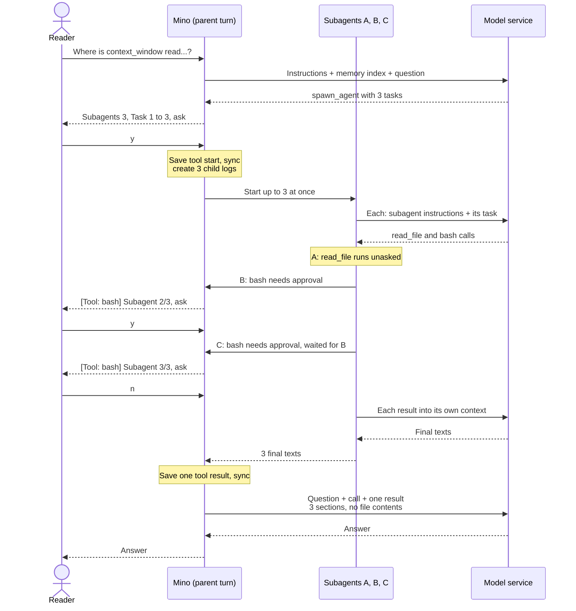

# Chapter 14: Delegate work to subagents

Applies to **0.14.x** · Source and release tag **[chapter-14](https://github.com/qshine/mino/tree/chapter-14)** · Application version **0.14.0**, released **2026-10-28**

Ask Mino three things about a project you do not know well: where the `context_window` setting is read, how its default is computed, and which tests cover it. In Chapter 13 the model would work through all three in one turn. Every file it opened with `read_file`, and every page of `grep` output, would stay in the conversation, and the answer needs perhaps a dozen lines of it. [Chapter 06](./06-context-compaction.md) compaction cannot help: it never summarizes the turn in progress or the two before it. And one turn allows only 16 tool calls, which a broad search can use up before it finds anything.

This chapter lets the model hand that work to **subagents**. A new tool, `spawn_agent`, takes a batch of up to ten tasks. Mino runs each task as a separate child Agent with its own context, its own session log, and its own limits, and returns only their final texts to the parent, as one tool result. The files the children read never enter the parent's context. The harder part is authority: each child acts in your project with your tools, so this chapter is as much about who approves what as about parallel work. To build this version, see [the Chapter 14 setup notes](../getting-started.md#try-chapter-14-from-source).

## 1. Three questions, one delegation

Illustrative output. The question, the task texts, the session IDs, the commands, and the model's wording are examples; the confirmation labels, the warning, the `[subagent N/M]` lines, and the layout of the result follow the current source. The session is in `manual` mode, and some field values are shortened to `...`.

```text
You> Where is context_window read, how is its default computed, and which tests cover it?

Assistant>
[Tool: spawn_agent]
Subagents: "3"
Task 1: "Find every place in this Go project where the context_window setting is read, validated, or defaulted. Use read_file only. Report file paths and functions."
Task 2: "Find how the default context window and the compaction threshold are computed. Search with grep, then report the constants, the formula, and file paths."
Task 3: "Find the tests that cover context_window and run them with go test. Report the test names and whether they passed."
Each subagent works in its own context with this session's permission mode; its tool calls that need approval will ask one at a time.
Approve this operation? [y/N] y
[subagent 1/3] read_file: completed
[subagent 3/3] read_file: completed

[Tool: bash]
Subagent: "2/3: Find how the default context window and the compaction thres…"
Command: "grep -rn ContextWindow internal"
Working directory: "/path/to/mino"
Environment: "..."
Limits: "Timeout: 30s; combined output limit: 65536 bytes."
Sandbox: "on: writes only inside /path/to/mino, temporary and cache directories; protected paths and ~/.mino blocked; no network."
The kernel confines this command's writes and network; it still reads what your account can read, except protected files.
Approve this operation? [y/N] y
[subagent 2/3] bash: completed

[Tool: bash]
Subagent: "3/3: Find the tests that cover context_window and run them with g…"
Command: "go test ./internal/... -run Context"
...
Approve this operation? [y/N] n
[subagent 3/3] bash: denied
[subagent 1/3] read_file: completed
[subagent 1/3] read_file: completed
[subagent 2/3] read_file: completed

[Tool result: completed]
Subagent results: 3 tasks, 3 completed, 0 failed, 0 cancelled.

[1/3] completed · session 5d0e2a7c9b1f4e6a8c3d5b7f9a1e2c4d · 4 requests, 3 tool calls
context_window is decoded and validated in internal/config.go, passed to the Agent in internal/app.go, and replaced by the default when it is zero in internal/agent/agent.go.

[2/3] completed · session 8b4f1c6e2a9d7b3f5e1c8a4d6b2f9e7a · 3 requests, 2 tool calls
DefaultContextWindow is 128000 (internal/agent/agent.go). internal/agent/compact.go reserves min(8192, window/8) tokens for output; the rest is the input budget.

[3/3] completed · session 2e7a9c4b6d1f3e8a5c2b7d9f4a6e1c3b · 3 requests, 2 tool calls
internal/config_context_test.go tests the field's validation, and the compact_*_test.go files in internal/agent test the budget. The go test command was not approved, so the tests were not run.

Assistant> context_window is read in internal/config.go and defaults to 128,000 tokens... The tests exist but were not run in this session.
```

Count what you were asked. Approving `spawn_agent` was one question, and it did not approve anything the children would do. Child 1 only read files, which never asks. Child 2's `grep` and child 3's `go test` each asked separately, and each question opened with a `Subagent` line naming the task it came from. Child 3's question appeared only after you had answered child 2's. You denied it, and child 3 did not fail: its model saw the denial and reported that the tests were not run.

Which tasks the model writes, which tools each child uses, and how the answers are worded are all model-dependent. The program guarantees the rest: the questions, the order in which they appear, the result's layout, and that the parent's next request carries those three short sections instead of the files behind them.

## 2. What each side sees

### 2.1 What a subagent receives

A subagent starts from nothing the parent said. Its first and only user message is its task, so the tool description and the default `SOUL.md` both tell the model to write every task as a complete instruction. The rest of its request is assembled from what the parent already has.

Table 14-1. What a subagent shares with its parent turn, and what it gets of its own.

| | Parent turn | Each subagent |
| --- | --- | --- |
| Instructions | Your `SOUL.md` and the session's skill catalog | The same `SOUL.md`, then a fixed subagent paragraph, then the same catalog |
| First user message | Your question | Its task text |
| Conversation history | The session's log | None: a new log of its own |
| Memory index | Rendered at the start of the turn | The same index, never rescanned |
| Tools | All configured tools | The same tools, without `spawn_agent` and `memory_save` |
| Permission mode | The session's mode | The same mode, checked by the same policy |
| Limits | 8 requests and 16 tool calls per turn | Its own 8 requests and 16 tool calls |
| Model settings | `model`, `base_url`, `api_key`, `context_window` | The same, with its own compaction |

The fixed paragraph tells the model that it is a subagent, that it cannot see the other conversation or ask you anything, that other subagents may be working in the same project at the same time, and that its final message is returned as its entire result and must fit a stated number of bytes. With three tasks, that number is 16,384.

The skill catalog arrives the way [Chapter 07](./07-skills.md) froze it for the parent: the child's log starts with a copy of the parent's `session_skills` record rather than a new scan, so the parent and its children agree on which skills exist, and `skill_view` works in both. The memory index is the one the parent rendered when the turn began, as in [Chapter 13](./13-user-memory.md); `memory_view` still works, but no child scans `~/.mino/memory` again or repeats a notice about a broken file.

### 2.2 What comes back to the parent

While a child works, its own text is not shown. Three answers streaming into one terminal at once would be unreadable, and the final texts appear in the tool result anyway. Each tool result inside a child becomes one status line, such as `[subagent 2/3] bash: completed`, and any notice a child emits, for example from its own compaction, carries the same prefix.

When every child has finished, Mino builds one tool result. Its first line counts the outcomes. Each task then gets a header in the order you saw the tasks, not the order they finished: its status, its session ID, and how many requests and tool calls it used, followed by its last answer text. A child that stops early is `failed` with its reason, cut to 256 bytes, for example `[2/3] failed: Tool limit reached.` when it ran out of requests or tool calls, or the error text when the model service refused a request. One failure does not stop the others.

The texts share a budget of 48 KiB, split evenly: 16 KiB each for three tasks, about 4.8 KiB each for ten. A longer text is cut on a character boundary and marked `[truncated N bytes]`. An even split means one verbose child cannot crowd out the others, and the whole result always fits below the 64 KiB tool output limit from Chapter 03.

The result's status is `completed` only if every task completed. If you press Ctrl+C during the batch, Mino cancels the children, records the result as `cancelled` with every unfinished task marked `cancelled`, and exits, as Ctrl+C has done during any tool call since Chapter 03. Otherwise it is `failed`, but every section is still included, so the model can use the tasks that did finish.

That result is what the parent's next request contains, paired with the `spawn_agent` call like any other result. The three files child 1 read, the `grep` output, and child 3's denied command all stay in the children's logs.

## 3. One call, many loops



Figure 14-1. The parent turn makes two requests, with one call and one result between them. Everything the children read and run happens inside that call, in their own contexts and their own logs.

Scroll the diagram horizontally on narrow screens. The order inside the call matters. Mino checks the arguments and the per-turn limit, asks you, and saves the `spawn_agent` start record, as it does for every tool since [Chapter 03](./03-tools-and-bash.md). Only then does it create every child's log, before any child runs, and start the children through a small pool: three at a time by default, so with ten tasks the fourth starts when one of the first three finishes. The parent waits until all of them are done, then saves the single result before its next request.

### 3.1 Why the batch runs inside one tool call

The obvious way to run things in parallel would be to let the model request several tool calls in one response and run those calls at the same time. Mino does not do that. Since [Chapter 04](./04-recovering-tool-turns.md), the parent's history is a strict sequence: each call is started, then given its result, in the order the model requested them, and that order is what lets a restart tell which call may have run without a saved result. Interleaving starts and results would need a new record format, and earlier releases could no longer read the sessions.

Putting the parallelism inside one call keeps the parent's history exactly as it was: one `tool_start` and one `tool_result` per call, record version 4, no new record kinds. The children's own records go into their own logs, each a normal sequential session.

The cost is that the parent waits for the slowest child. The model cannot act on the first result while the others are still running, and a task that needs a full minute holds the whole batch for that minute. The model can still call `spawn_agent` again in a later step of the same turn, so the boundary is per batch, not per turn.

### 3.2 Limits on a batch

A delegation multiplies requests, so every dimension has a bound:

- **Per call:** 1 to 10 tasks, each a non-empty UTF-8 string of at most 8 KiB, at most 32 KiB together. The arguments are parsed strictly: a repeated or unknown key is `invalid_arguments`.
- **Per turn:** at most 16 subagents. A batch that would go past that is `denied` before you are asked, with a result telling the model how many it has already started. A batch of 10 followed by one of 7 therefore asks you once, not twice.
- **Per child:** its own 8 requests and 16 tool calls, so a single turn can spend at most 16 × 8 child requests on top of the parent's own 8.
- **At once:** 3 by default, or `max_concurrent_subagents` in `~/.mino/config.json`, from 1 to 10. Mino never prompts for this field; see [the setup notes](../getting-started.md#configure-subagent-concurrency).

There are no automatic retries; Mino has never retried a failed request since [Chapter 01](./01-terminal-chat.md). A rate-limit error from your model service fails that one task with the error as its reason, so if your provider limits concurrent requests, lower `max_concurrent_subagents`.

The terminal does not show token counts, and the children's tokens are no exception. [`mino eval`](./11-evals.md) adds them to its token totals, so a case that delegates reports what the whole batch cost.

### 3.3 Child logs, crashes, and `/clear`

Each child's log is `~/.mino/sessions/<session-id>.agents/<child-id>.jsonl`, where `<child-id>` is a new random ID Mino generates, never the model's call ID. The directory is created with mode `0700` and the files with `0600`, like the session logs from [Chapter 05](./05-jsonl-sessions.md). The ID in each result header is that file's name, so you can open a child's log to see exactly what it read and ran.

These logs are records, nothing more. `/sessions` lists only top-level `<id>.jsonl` files, so children never appear there, and `/resume` cannot select one. If Mino is killed during a batch, the parent's log ends with the `spawn_agent` start and no result. On restart that is the ordinary Chapter 04 case: the call is closed as `unknown` and you are asked to acknowledge it before chat continues. The child logs stay as they were; Mino never repairs them, reopens them, or reruns their tasks.

`/clear` now removes `<session-id>.agents/` together with the session's history, and its confirmation says `Clear this session's saved history, including its subagent logs?`.

If a child cannot write its log, Mino cancels the other children and stops chat, as it does when the parent's own history cannot be saved: a batch whose records may be incomplete is not one to continue on.

## 4. Approval does not travel down

### 4.1 One question at a time

A subagent asks for the same things the parent would. Its calls go through the [Chapter 10](./10-guardrails.md) decision with the session's own policy, so the mode you chose applies inside every child. `spawn_agent` itself is not read-only, names no project file, and is not sandboxed, so it falls through to ask in `manual` and `accept-edits`.

Table 14-2. Decisions by mode for a delegation and for the calls its subagents make.

| Call | `manual` | `accept-edits` | `bypass` |
| --- | --- | --- | --- |
| `spawn_agent` | asks | asks | runs, shown |
| A subagent's `read_file`, `skill_view`, `memory_view` | runs, no question | runs, no question | runs, no question |
| A subagent's sandboxed `bash`, `write_file`, `edit_file` | asks | runs, shown | runs, shown |
| A subagent's `bash` with `sandbox: false`, `mcp_` tools | asks | asks | runs, shown |
| A batch past 16 subagents in one turn | denied | denied | denied |

In the opening scenario under `accept-edits`, the two Bash questions disappear: sandboxed Bash runs unasked there, as [Chapter 12](./12-sandbox.md) established, and each call is printed with every field, each line prefixed with its `[subagent N/M]` label. The `spawn_agent` question remains.

Mino currently does not let one approval cover the children's calls. The alternative, an "approve the batch and everything in it" answer, would turn one question about a list of task texts into consent to commands nobody has written yet. The cost of the current choice is more questions, which is why `accept-edits` and the sandbox matter more here than in any earlier chapter.

Children run at the same time, but there is only one terminal. All children of a batch share one gate: when a child needs to ask, it waits until no other question is open, and while its question is open, the other children's status lines wait too. The other children are not stopped, but each one waits at its next status line or completed response until the question closes. Each question gains a first field, `Subagent`, with the child's position and the first line of its task, cut to 60 characters, so you can tell which of three similar `grep` commands you are approving.

### 4.2 The sandbox now closes `~/.mino`

Under the Chapter 12 profile a sandboxed command could read any file except the protected patterns. That included `~/.mino`: `config.json` with your API key, every session log, and every memory. In `accept-edits` such a command runs unasked, and with subagents several of them can run at once while you watch status lines go by.

The profile now denies both reading and writing `~/.mino`, and the real directory behind it if `~/.mino` is a symbolic link, for Bash and for stdio MCP servers added with `--sandbox`. The confirmation's `Sandbox` line says so: `protected paths and ~/.mino blocked`. Mino applies this to every sandboxed command, not only to subagents, because a command that runs unasked should not be able to read your key. Ordinary commands do not need that directory, and Mino's own tools, such as `memory_view`, read it without going through Bash.

The cost is that `cat ~/.mino/memory/uses-pnpm.md` now fails with `Operation not permitted` inside the sandbox. The boundary is the sandbox itself: a command you approve with `sandbox: false`, or any command on a system without `sandbox-exec`, can still read the directory.

### 4.3 Where subagents stop

- **One level deep.** Children do not get `spawn_agent`, so a subagent cannot start its own.
- **No memory writes.** Children do not get `memory_save`. A memory can be proposed only by the parent conversation, whose context you have been part of.
- **No questions to you.** A child cannot see your conversation or ask for clarification; an unclear task comes back as an unclear answer.
- **No coordination between children.** They share one project directory, and Mino does not lock files between them. The tool description asks the model not to give parallel tasks work on the same files; the program does not check.
- **The parent sees conclusions, not evidence.** It receives each child's final text and has to trust it, or open the child's log, or delegate a check.
- **Not included:** custom subagent definitions, background subagents that keep running after the call returns, and a grant that approves everything a batch does.

## 5. Check it with evals and tests

Two new cases bring the replay suite in `scripts/check.sh` to thirteen. Replay always runs subagents one at a time: the scripted model answers requests in the order they arrive, first the parent's, then all of child 1's, then child 2's, then the parent's final request, and concurrent children would make that order unpredictable. Live runs use your configured concurrency.

- `subagent-batch` delegates two tasks, each of which reads one file with `read_file` in its child. The graders require that `spawn_agent` completed, that `read_file` was **not** called, and at most two requests. Graders read only the parent's session log, so the absence of `read_file` there is the evidence that the reads stayed in the children. It is `live: false`, because it asserts a path a real model need not take.
- `subagent-approval` approves only `spawn_agent`. The child's `rm -rf build` is therefore denied, the child reports it, and the grader checks that `build/out.txt` still exists.

```bash
go build -o bin/mino ./cmd/mino
bin/mino eval ./evals
```

Illustrative output: on macOS with `sandbox-exec`, thirteen rows pass; the three `sandbox-*` cases from Chapter 12 still fail where no sandbox exists.

The Go tests need no API key:

```bash
go test ./internal/agent -run 'Subagent|Spawn'
go test ./internal/sandbox -run TestMinoDataDirectoryIsBlocked
go test ./internal -run TestMaxConcurrentSubagentsConfiguration
```

[`TestSubagentsRunInParallelAndReturnOneResult`](https://github.com/qshine/mino/blob/chapter-14/internal/agent/subagent_test.go) follows Figure 14-1. Its fake model service holds each child's first request until all three are in flight, which can happen only if they really run at the same time. It then checks what each child received (the SOUL text first, the byte budget, the skill catalog, the memory index, and a tool list with `memory_view` and `skill_view` but without `spawn_agent` and `memory_save`), that you were asked once, that the result lists the three tasks in order, that no child's text was streamed, and that the parent's log holds exactly one tool start and one tool result while three child logs exist.

The neighbouring tests check that questions never overlap and carry the `Subagent` field, while `bypass` asks nothing and prints prefixed lines; that 10 tasks followed by 7 are denied before a second question; that cancelling the turn cancels the batch and records a `cancelled` result; that a child storage failure stops chat; that a crash during a batch becomes `unknown` after restart without rerunning the child; that `/sessions` ignores child logs and `/clear` removes them; that arguments are bounded; and that ten long texts share the budget and stay valid UTF-8. The sandbox test reads, lists, and writes a fake `~/.mino` under the profile and expects all three to fail.

These checks establish what the program asks, sends, records, and returns. They do not establish that a real model writes self-contained tasks, delegates when it should, or summarizes its findings faithfully.

## 6. Chapter outcome and next step

Return to the three questions about `context_window`. In Chapter 13 every file the search opened would have stayed in the conversation. Now the parent turn holds one call and one result of three short sections, and the files live in three child logs you can open. Every child works under the session's permission mode, its questions reach you one at a time with its label, and approving the delegation approves only the delegation. The limits are as explicit: one level deep, no memory writes, at most 16 subagents a turn, and a parent that waits for the slowest child.

Every subagent so far is the same general helper: your SOUL, every tool but two, and whatever role the model writes into the task each time. A project that wants a dedicated reviewer, or a read-only explorer that cannot run Bash at all, has no way to say so. [Chapter 15](../plan-todo-chapters.md) is planned to add custom subagent definitions in `.agents/agents/<name>.md` that name a role, describe when to use it, and may narrow its tools. The [chapter roadmap](../plan-todo-chapters.md) records the status of every chapter.
