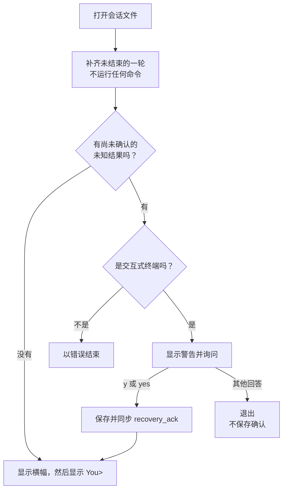

# 第 04 章：如实恢复中断的工具调用

适用版本：**0.4.x** · 源码与发布标签：**[chapter-04](https://github.com/qshine/mino/tree/chapter-04)** · 程序版本：**0.4.0**（2026-10-21 发布）

让 Mino 把“牛奶”加进购物清单，批准命令，然后进程在结果保存之前没了。在[第 03 章](./03-tools-and-bash.md)里，重启后的 Mino 绝不会重跑这条命令，但也从不把这次尝试告诉模型。文件知道清单里可能已经有了牛奶，模型却不知道。

本章沿用同样的记录，改变的是 Mino 怎样使用它们：中断的工具问答会带着配对结果和一条运行时提示回到模型面前；遇到 `unknown` 结果，必须先由你确认，对话才能继续。请按[第 04 章源码准备说明](../getting-started.md#从源码体验第四章)跟着操作。

## 1. 一条结果没来得及保存的命令

从一次普通的工具问答开始。模型请求追加一行，你批准了。

交互示意，节选。批准界面中的目录、环境和限制行已省略。

```text
You> 把 milk 加到 shopping.txt 里。

Assistant>
[Tool: bash]
Command: "echo milk >> shopping.txt"
Approve this operation? [y/N] y
```

Mino 保存 `tool_start`，然后运行命令。现在假设 `tool_result` 记录写入文件之前，Mino 停了下来：写入结果时磁盘已满，或者进程被强行结束。追加可能已经发生，文件里却没有任何内容能说明它到底发生了没有。

如果重启的是 `chapter-03` 版本，Mino 会给你一条提示，却不会把这一轮的任何内容交给模型。你再说一遍“把 milk 加到 shopping.txt 里”，模型没有理由知道之前有过一次尝试；如果它请求同样的追加而你又批准了，清单里就会有两行 milk。换成重启 `chapter-04` 版本，你最先看到的是一个问题。

交互示意。

```text
An interrupted tool turn was recovered without executing commands.
A previous command started, but its result is unknown. It may have changed files or external systems. Mino has not rerun it. Review those effects before continuing.
Do you understand that these commands may already have run? [y/N] y
Mino - Chapter 04: Recovering Tool Turns
History is restored on startup. Bash commands require approval. Use /exit, Ctrl+D, or Ctrl+C to quit.

You> 现在清单里有 milk 了吗？

Assistant> 之前的追加可能已经执行，但结果没有保存下来。如果你批准，我可以读取 shopping.txt 确认一下。
```

回答措辞取决于模型，每次都可能不同。确定的是：在你提问之前，模型已经收到了那次中断的调用、它的 `unknown` 结果，以及 Mino 的提示。接下来三节分别解释这三样东西。

## 2. 已保存的记录能说明什么

恢复仍然依靠[第 03 章的保存点](./03-tools-and-bash.md#_4-1-一轮问答中的保存点)：Bash 运行前已同步 `tool_start`，下一次模型请求前已同步 `tool_result`。重启时，Mino 根据找到的记录，为未结束问答中每个尚未解决的调用补上结果，再以 `interrupted` 结束这一轮。它绝不为了弄清情况而执行任何东西。

表 04-1：每个补上的结果只陈述已保存记录能够证明的内容。

| 已保存的证据 | 恢复结果 | 你能据此判断什么 |
| --- | --- | --- |
| 有调用，没有开始记录 | `not_executed` | Mino 未到达已记录的执行边界。 |
| 有开始记录，没有结果 | `unknown` | 操作可能已经发生，但结果不可知。 |
| 调用已有结果 | 保留该结果 | 已记录的结果可以进入后续上下文，无需再次执行。 |

牛奶这条命令落在中间一行。保存了开始记录，不证明进程已创建；没有结果，也不证明命令失败。对这种状态，`unknown` 是唯一诚实的名字。第 03 章已经把这些结果写进磁盘；本章改变的是谁能看到它们。

## 3. 把中断的问答连同结果一起重放

含有工具调用的一轮问答，无论以失败、取消还是中断结束，现在都会进入后续上下文。这包括上面的崩溃，触及 8 次请求或 16 次调用上限而停止的一轮，以及在命令执行中被取消的一轮。

### 3.1 下一次请求包含什么

重启之后，你关于牛奶的问题会带着恢复出的这一轮一起发出。下面的节选经过简化：它展示输入项的顺序和内容，省略了推理项和部分字段。`call_1` 代表模型返回的标识。

```json
[
  {"role": "user", "content": "把 milk 加到 shopping.txt 里。"},
  {"type": "function_call", "call_id": "call_1", "name": "bash", "arguments": "{\"command\":\"echo milk >> shopping.txt\"}"},
  {"type": "function_call_output", "call_id": "call_1", "output": "{\"status\":\"unknown\",\"output\":\"Execution was started but its result was not saved. The operation may have happened. Do not automatically retry it.\"}"},
  {"role": "assistant", "content": "Mino runtime notice: the previous turn ended with status interrupted. Tool results above are retained; no command was automatically retried."},
  {"role": "user", "content": "现在清单里有 milk 了吗？"}
]
```

调用和结果保持同一个 `call_id`，与已完成的问答完全一样。提示来自 Mino，而不是模型；它标明是运行时提示，并记下这一轮的结束状态。这些输入项会留在对话上下文中，随之后的每一次请求发送，而不只是下一次。

提前结束、但没有任何工具调用的一轮问答仍被排除。它没有需要报告的工具影响，而不完整的流式文本也不能被当成最终回答。

默认指令 `SOUL.md` 也相应扩充了一行：被拒绝、失败、取消或结果未知都不算成功，结果未知的操作绝不能自动重试。和所有指令一样，它引导模型，但不强制执行任何事。

### 3.2 为什么重放，而不是隐藏或重试

还有两个更简单的选项。第 03 章隐藏这一轮，重放规则简单，模型却不知道可能存在的影响。Mino 也可以重跑命令，但对追加操作来说，那恰好会造成你想避免的重复；而且 Mino 无法判断哪些命令可以安全重复。

Mino 目前的做法是重放已记录的配对，并附上明确的提示。代价是上下文里多了一轮没有最终回答的问答，模型还得理解一个“也许发生了”的结果。它能否理解得好，取决于模型。程序保证的范围更窄：模型收到了证据，并且没有你新的批准，任何命令都不会再次运行。

## 4. 确认结果未知的操作

仅仅告诉模型还不够。模型不经你同意就打不开 `shopping.txt`，而计算机之外的影响，比如一条可能已经发出的消息，也只有你能去核实。Mino 目前为 `unknown` 多加了一步：启动时停下来，等你确认这个结果。

### 4.1 启动时的确认关卡



图 04-1：只有 `unknown` 结果会触发询问，也只有已保存的确认能解除它。

这个问题出现在启动横幅之前，回答之前不会出现 `You>` 提示。与批准命令一样，只有 `y` 或 `yes` 算数。随后，Mino 为每一轮含有未知结果的问答追加一条 `recovery_ack` 记录，同步之后才开始聊天。

其他任何回答，包括直接回车，都会让 Mino 退出且不保存确认。补上的结果已经写入磁盘，但下次启动还会再问，之后每次启动都会问，直到确认被保存为止。重定向或管道输入无法确认；Mino 会以 `Unknown tool results require acknowledgement in an interactive terminal` 结束。

终端的关卡不是唯一一道检查。只要还有未确认的未知结果，Agent 自身就会以 `Acknowledge unknown tool results before continuing` 拒绝新问题，因此即使换一个交互入口，也不能靠“不去询问”跳过这一步。

`not_executed` 结果不会触发询问。从未开始的调用不可能改变任何东西，重放和启动提示就已足够。

### 4.2 确认意味着什么，不意味着什么

一条 `recovery_ack` 记录说明：你确认了自己知道这条命令可能已经运行。仅此而已。

它不会重跑命令，不会检查文件，也不会改变结果。模型在之后的请求中看到的仍然是 `unknown`。如果你想知道清单里有没有 milk，可以自己查看 `shopping.txt`，也可以让模型请求读取，再由你批准。

这种设计的代价是一次无法通过配置关掉的打断：即使结果未知的只是 `go version`，Mino 也会停下来，因为它分不清命令是无害还是有害。只要保存了开始记录，就足以触发这道关卡，哪怕进程根本没有创建。

## 5. 打开第 03 章的会话

第 04 章在同一个会话文件中写入同样的 `v: 2` 记录，只新增一种记录类型 `recovery_ack`。它能直接读取 `chapter-03` 写下的文件，并带来两个可见的变化：第 03 章排除的工具问答，现在会连同提示一起进入上下文；第 03 章留下的 `unknown` 结果从未被要求确认，现在会触发启动时的询问。

反方向在你确认之后就行不通了。`chapter-03` 不认识 `recovery_ack` 这种记录，会拒绝打开文件。切换版本前的备份步骤见[第 04 章源码准备说明](../getting-started.md#从源码体验第四章)。

## 6. 用模拟测试检查恢复

关于牛奶的回答再合理，也证明不了重放或关卡生效了；模型可能只是猜的。在 `chapter-04` 的仓库根目录运行两个恢复测试：

```bash
go test ./internal/agent -run 'TestToolHistoryRecoveryPreservesPairsAndAcknowledgement|TestUnknownResultGatesChatUntilAcknowledged' -v
```

它们使用临时用户目录和预先写好的记录，不连接模型服务，因此不需要 API Key。两个测试名都应显示 `PASS`，最后该包显示 `ok`。

[第一个测试](https://github.com/qshine/mino/blob/chapter-04/internal/agent/history_tools_test.go)让一轮含两个调用的问答分别停在模型响应之后、第一个工具开始之后、第一个结果保存之后，再重新打开文件。每种情况下，都有六个输入项回到上下文：你的输入、两个调用、两个结果和运行时提示。只有缺少结果的开始记录才会带来确认要求；这一状态在再次重新打开后依然存在，保存 `recovery_ack` 之后才彻底解除。

第二个测试保存第 1 节的情形，即有开始记录却没有结果，再重新打开。它检查重放的输入中包含该调用的 ID、`unknown` 结果和提示；确认之前提问会被拒绝；拒绝确认会结束启动，随后接受确认，文件中恰好留下一条 `recovery_ack`。

这些测试说明了重建出的上下文是什么，以及关卡何时打开。它们不模拟真实的崩溃或磁盘写满，不运行终端的交互式输入检查，也不展示模型如何理解 `unknown`。

## 7. 本章小结与下一步

牛奶那条命令不再从对话中消失。崩溃之后，模型会收到这次调用、诚实的 `unknown` 结果和 Mino 的提示；而在任何事情继续之前，你会先确认自己知道命令可能已经运行。没有任何命令被重试；怎样处理可能已经发生的影响，仍取决于你，以及一次新的、经过批准的工具调用。

这一切仍然发生在同一个对话文件里。[第 05 章](./05-jsonl-sessions.md)见 `chapter-05` 版本；它让你为无关的任务开启新会话，同时保留之前的会话，连同其中恢复出的工具问答，随时可以继续。
