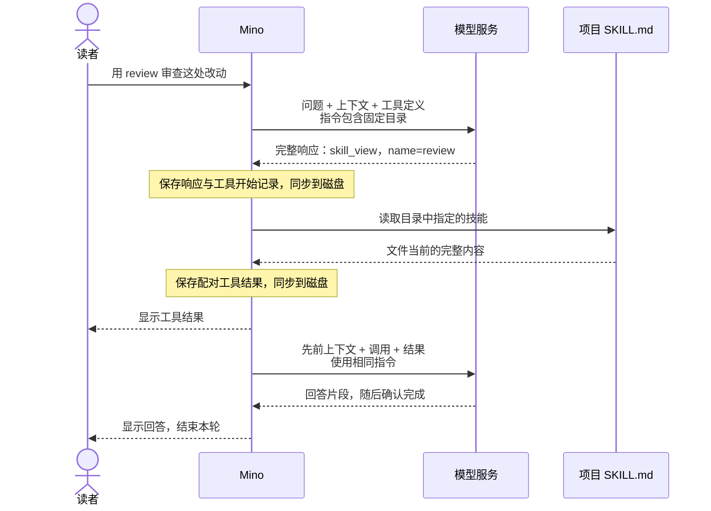

# 第 06 章：用 Skills 按需加载任务知识

适用版本：**0.6.x** · 源码与发布标签：**[chapter-06](https://github.com/qshine/mino/tree/chapter-06)** · 程序版本：**0.6.0**（2026-10-11 发布）

你让 Mino 审查一处改动。对话里有代码，却没有项目约定的审查方法：先看测试，找出具体的失败情形，把确定的问题与不确定之处分开。Skill 把这些可复用的指引放进文件，让模型在需要时请求读取。

先完成[第六章源码与技能准备](../getting-started.md#从源码体验第六章)。本章区分两种输入：简短且固定的可用技能目录，以及选中技能的完整文本。

## 1. 让模型选择需要的指引

假设项目里有一个名为 `review` 的技能，简介是“结合测试和具体证据审查代码改动”。你输入“用 review 技能审查这处改动”，并附上改动内容。Mino 把技能名称和简介连同已加载的 SOUL 指引放入请求的 `instructions`。这份发现目录不包含技能正文。

如果模型决定使用它，就返回一个 `skill_view` 工具调用，参数为 `{"name":"review"}`。Mino 读取指定文件，把完整内容作为工具结果交回模型。模型随后可以按其中的指引审查你提供的改动，或继续请求补充证据。**模型选择技能，Mino 执行读取。** 回答里提到技能名称，并不会触发加载。

交互示意。模型是否选择该技能，以及最终怎样回答，取决于配置的服务。



图 06-1：模型先收到发现元数据，再选择技能；完整文本通过配对工具结果进入对话。输入与最终响应仍按既有规则持久化。

窄屏下可横向滚动图表。读取成功后，终端在 `[Tool result: completed]` 下显示内容；模型的下一个响应可能给出回答，也可能请求其他工具。技能是任务指引，不是可执行插件，也不是新的工具定义。

## 2. 在会话中固定一份目录

Mino 只发现进程启动时确定的项目目录下、直接位于 `.agents/skills/<name>/SKILL.md` 的文件。程序读取 YAML 中的 `name` 与 `description`，按名称排序，把 `session_skills` 快照存入会话日志。快照也记录项目位置。即使目录为空，Mino 也会先写入并同步到磁盘，再把它用于模型指令。

一次加载所有技能正文，会让无关指引占据上下文；每次请求前重新扫描简介，可以及时发现编辑，却会改变对话中的指令。Mino 选择**固定发现元数据、按需读取正文**，让提示词的这一部分在会话内保持稳定，为模型服务复用提示缓存提供条件。每个常规请求仍会发送目录；“只加载一次”指文件系统发现，而不是只传输一次。

代价是目录会有意保留旧内容：修改简介或添加技能，不会更新已有会话。目录稳定也不保证缓存命中或账单降低。Mino 没有测量缓存命中，其他请求内容和服务行为仍会影响结果。

表 06-1：会话操作在明确的边界上保留或替换发现元数据。

| 操作 | 之后使用的目录 |
| --- | --- |
| 启动新会话，包括 `/new` | 扫描当前进程启动时确定的项目目录一次，保存结果。 |
| 继续、`/resume`，或重启已初始化的会话 | 恢复已保存的目录和项目位置，不重新扫描。 |
| 确认 `/clear` | 保留目录，删除该会话的对话与摘要。 |
| 首次使用旧章节创建的会话 | 按当前进程的项目目录初始化一次，并保存目录。 |

重启进程时可以换一个工作目录。已有会话仍指向它记录的项目，`/new` 则在新进程的启动目录下发现技能。这不会改变 Bash 的目录：Bash 在所有会话中都使用自己启动时确定的目录。如果恢复的技能原项目已经不存在，目录仍能恢复，但之后的读取会失败。

这份快照只固定技能。SOUL 仍在每次进程启动时读取一次；编辑后重启，即使技能目录相同，整体指令也可能变化。快照写入或同步失败时，程序会在使用新目录之前停止聊天。`/new` 遇到无效元数据会报错，并保留原来选中的会话；发现阶段接受哪些文件，见[技能文件规则](../getting-started.md#编写项目技能)。

## 3. 读取正文不增加权限

`skill_view` 接受目录中的名称，不接受路径。Mino 只读取该项目下对应的 `SKILL.md`，检查文件边界，并要求内容是非空 UTF-8 文本，最大 64 KiB。程序不会自动加载技能引用的其他文件，也不会运行技能目录中的脚本。文件缺失、被拒绝或无法读取时，会返回模型可见的失败工具结果。

读取获得的是**调用当时**的文件。如果你在会话开始后编辑审查步骤，新的 `skill_view` 调用会看到改动，但发现目录中的简介保持不变。保存的结果记录这次调用实际返回的内容。重启时重放已保存的结果，不重新读取文件；模型之后新发起的调用才会再读一次。

Mino 不为这次限定范围的读取请求确认。权限来自程序中的工具实现，不是模型提供的标志。如果技能要求模型通过 Bash 运行测试，随后出现的 Bash 调用仍要逐次取得交互式批准，默认拒绝。技能读取器的文件限制不会把 Bash 变成沙箱。

指令把名称和简介标记为发现数据，把技能文本标记为任务指引，不能覆盖用户指令或工具批准。完整文件保留在普通工具结果中，不追加到系统指令。这保留了内容在上下文中的来源，却不能证明模型会忽略其中每一条误导指令。Bash 批准和未知结果确认，仍由程序强制执行。

Agent（智能体）在行动前保存并同步完整模型响应，在读取前保存工具开始记录，在下一次请求前保存配对结果。存储失败会停止聊天。一轮问答最多八次模型请求、十六次工具调用的既有限制，也包含技能读取及其后续请求。下一次请求前的上下文预算会计入固定目录、工具定义和返回文本。上下文压缩可以摘要较早的技能交互，但不会改变常规指令中的目录；单独的摘要请求不带工具。

## 4. 检查请求，而不只听回答怎么说

在 `chapter-06` 的仓库根目录运行：

```bash
go test ./internal/skills ./internal/tools ./internal/agent -run 'TestScan|TestSkill'
```

这些测试使用临时项目、会话文件和本机模拟服务，不需要真实 API Key，也不会发送付费模型请求；模拟服务需要绑定本地端口的权限。通过时，每个包都会报告 `ok`。

目录测试在两轮问答之间修改简介，再创建新会话、恢复原会话、清空它，并从不同项目目录重启。测试比较发出的 `instructions`：原会话始终保留原目录，新会话才看到修改后的简介。另一个用例检查文件出现后，空目录快照仍为空。这些检查证明会话内的稳定性，不证明服务商的缓存行为。

工具循环测试返回一个模拟 `skill_view` 调用，再检查下一次请求：正文必须位于具有相同 `call_id` 的结果中，请求指令只包含元数据。读取无需确认，删除文件后重新打开历史仍能恢复已保存的结果。单独的文件测试在发现后修改正文，验证新的读取能看到改动，同时拒绝未知名称和无效文件，并守住项目边界。

其他用例覆盖快照同步失败、被拒绝的 `/new`、无效快照记录，以及把目录计入预算的上下文压缩。它们共同验证提供给模型的上下文与控制流程。真实回答里一句“我使用了 review 技能”，既不能证明文件已读取，也不能证明缓存命中。

## 5. 本章小结与下一步

开头的审查请求现在能通过具名工具调用，取得项目的审查方法。发现目录在会话中保持固定，每次请求读取则把当前文件作为有来源的对话上下文交给模型。技能提供指引，不增加执行权限，也不保证审查质量。

`skill_view` 说明读取可以由代码限定范围，但它只能读技能文件。其他项目文件仍要经过通用 Bash，而路径规则无法约束 Bash。规划中的[第 07 章：文件工具](../plan-todo-chapters.md)将加入限定在项目目录内的结构化读取和需要批准的写入。
