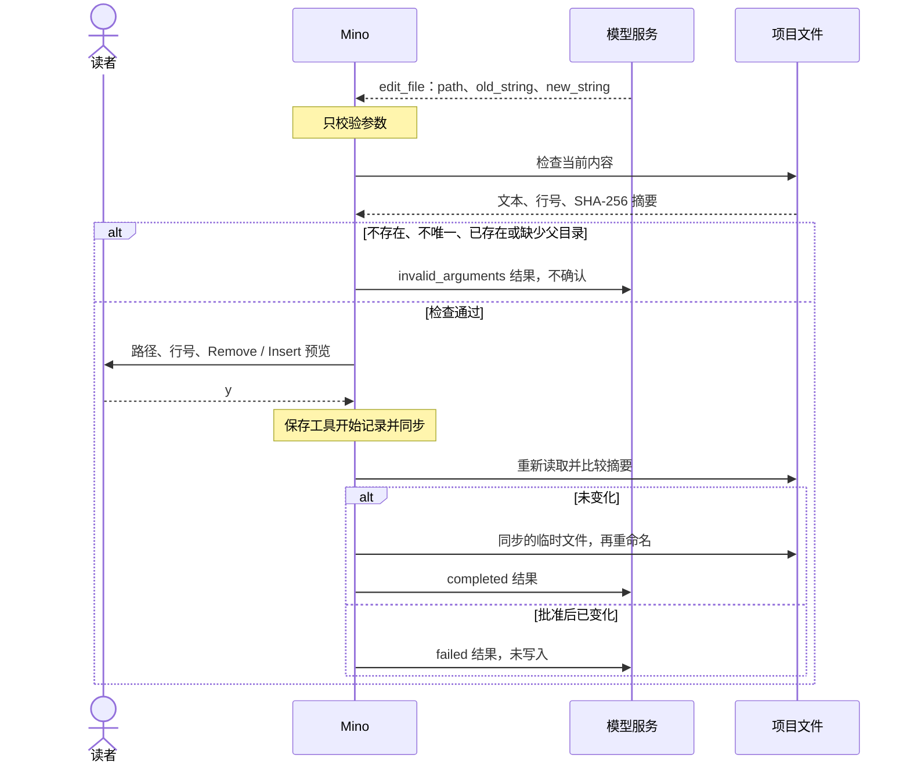

# 第 07 章：用文件工具读写项目文件

适用版本：**0.7.x** · 源码与发布标签：**[chapter-07](https://github.com/qshine/mino/tree/chapter-07)** · 程序版本：**0.7.0**（2026-10-11 发布）

你让 Mino 把 `greet.go` 里的一个常量从 `"hi"` 改成 `"hello"`。在[第六章](./06-skills.md)，碰这个文件只能靠 Bash：模型会提出类似 `sed` 的命令，批准界面显示一串需要你自己解读的命令字符串。程序无法判断这串命令会动到哪些文件。

本章加入三个结构化工具：`read_file`、`write_file` 和 `edit_file`。每次调用都指明一个路径，程序可以在动手之前检查它。读取限定在项目内，无需批准；每次写入或编辑都会先告诉你具体改什么，经你批准后才执行。若要体验，请先阅读[第七章准备说明](../getting-started.md#从源码体验第七章)。

## 1. 两次工具调用完成一处小改动

在包含 `greet.go` 的项目目录启动 Mino，然后提出修改请求。

交互示意，含实测的工具输出行。提问和最后的回答是示例；`read_file` 结果、确认界面和编辑结果，与一次针对模拟模型服务的本地冒烟运行一致，项目路径替换为 `/path/to/project`。

```text
You> 把 greet.go 里的 greeting 改成 "hello"。

Assistant>
[Tool result: completed]
package main

const greeting = "hi"


Assistant>
[Tool: edit_file]
Path: "greet.go"
Project directory: "/path/to/project"
Starting line: "3"
Remove: "\"hi\""
Insert: "\"hello\""
Resulting file: "39 bytes, 3 lines"
Writes with your account permissions; approval applies only to this change to the current file.
Approve this operation? [y/N] y

[Tool result: completed]
Edited greet.go at line 3 (39 bytes, 3 lines).

Assistant> 已把 greet.go 第 3 行的 greeting 从 "hi" 改为 "hello"。

You>
```

这一轮问答里有两次交接。第一次，模型返回 `read_file` 调用，参数为 `{"path":"greet.go"}`。Mino 读取文件，把文本作为配对的工具结果交回模型，不需要问你：和 `skill_view` 一样，这次读取的范围由代码限定，所以程序把它标记为只读。Mino 仍会显示结果，让你看到模型收到了什么。

第二次，模型返回 `edit_file` 调用，带有 `path`、`old_string` 和 `new_string`。这时控制权交到你手里。确认界面显示要删除和插入的文本、起始行，以及修改后文件的大小。直接回车或输入 `n` 表示拒绝：文件保持不变，模型收到 `denied` 结果。输入 `y` 后，Mino 写入修改并把结果交回；模型随后可以回答，或请求下一个工具。

三个工具需要的参数和前提条件各不相同。

表 07-1：每个文件工具都有明确的参数和前提条件，只有读取免于批准。

| 工具 | 参数 | 批准 | 执行前必须满足 |
| --- | --- | --- | --- |
| `read_file` | `path` | 无需批准 | 项目内的普通 UTF-8 文本文件，最大 64 KiB |
| `write_file` | `path`、`content`、`mode` | 每次调用，默认拒绝 | `create`：目标不存在，父目录已存在。`overwrite`：已存在的普通文件，保留其权限 |
| `edit_file` | `path`、`old_string`、`new_string` | 每次调用，默认拒绝 | `old_string` 非空、与 `new_string` 不同，且在文件中恰好出现一次 |

没有“存在就覆盖、不存在就新建”的模式。模型必须说明自己要哪一种，确认界面也会写明：`Create a new file`，或 `Overwrite the existing file (N bytes)`。写入的确认预览新内容；编辑的确认预览被删除和插入的片段。预览最多显示 20 行、2 KiB，其余部分只显示未展示的字节数，而总字节数和行数始终列出。

## 2. 先检查再询问，批准后再核对

确认界面只有描述文件的当前状态才有意义。因此 Mino 在问你之前先读取目标，在你回答之后再核对一次。



图 07-1：检查只针对实时调用、发生在询问你之前；批准只覆盖你看到的内容，再次核对会拒绝其他情况。

在窄屏上可以横向滚动图表。所有结果，包括 `invalid_arguments`，都会作为普通配对工具结果保存并显示，然后才发出下一次请求。

### 2.1 为什么检查要单独成为一步

每个工具原本就有一个校验模型参数的步骤。在这一步顺便读文件、生成确认内容，看起来更简单。Mino 做不到，原因在于[第三章的回放规则](./03-tools-and-bash.md)：加载会话时，历史检查会对每条已记录的工具开始记录运行同样的校验，确认保存的参数依然合法。

如果校验要读文件，会话能否加载就取决于当前文件系统。你再次修改甚至删除 `greet.go` 之后，较早那轮编辑它的问答可能通不过检查，整个会话随之无法读取。Mino 目前的选择是：校验只针对参数，在校验和批准之间加入一个**只对实时调用执行的检查步骤**。检查读取文件、生成确认内容、记下看到的状态；回放从不运行它。

代价是每个写文件的工具都要多实现、并正确实现一个步骤；而且从检查到写入之间，文件仍有一小段时间可能被改动。批准后的再次核对，就是为这段时间准备的。

### 2.2 批准绑定到你看到的内容

检查会记录所读文件的 SHA-256 摘要；对 `create` 则记录目标不存在。你批准后，Mino 重新读取文件。内容不同时不写入任何东西，模型收到 `failed` 结果和 `File changed after approval; nothing was written.`。对于 `create`，如果目标在此期间出现，发布步骤会拒绝替换它。你的批准不会延伸到你没看过的内容。

如果检查本身失败，就没有值得批准的东西。文件不存在、`old_string` 找不到或出现多次、`create` 的目标已存在、父目录缺失，都会向模型返回 `invalid_arguments` 和简短原因，例如请它先读取文件、复制确切文本。你不会被打扰。

获批的写入先进入同一目录下的临时文件，并先同步。`create` 随后把它硬链接到目标名称，目标已存在时会失败而不是替换；`overwrite` 和编辑则把它重命名覆盖目标。最后同步目录。因此读这个文件的程序看到的要么是旧内容，要么是新内容，不会是写到一半的混合内容。与第三章相同，Mino 在写入前保存工具开始记录；如果进程在结果保存前停止，恢复后的结果是 `unknown`，不会自动再次写入。

## 3. 路径能够表达的边界

路径相对于**项目目录**：也就是启动 Mino 时所在的目录，与 Bash 使用的目录相同。`/new` 和 `/resume` 不会改变它。Mino 拒绝绝对路径和 `..` 越界，再通过 Go 的 `os.Root` 打开文件，拒绝通向项目外的符号链接。它还拒绝最后一段为符号链接的路径、FIFO 等特殊文件、有多个硬链接的文件（另一个名字可能指向别处的文件）、不是 UTF-8 或含 NUL 的文本，以及超过 64 KiB 的文件。

为什么要在安全防护一章之前做这些工具？Bash 接收的是任意字符串，任何路径规则都无法可靠地判断 `sed`、脚本或管道会动到哪些文件。结构化调用写明了目标，程序可以先检查、再向你展示准确的确认内容。**文件工具让第九章有了真正能够限定范围的对象。** Bash 本身没有变化：每条命令仍需单独的默认拒绝批准，文件工具不会放宽它。

免批准的读取也有代价。`read_file` 返回的内容会发送给配置的模型服务，并保存到会话日志。本章不区分普通文件和敏感文件，项目里的 `.env` 和 `greet.go` 一样可读。受保护路径计划在[第九章](../plan-todo-chapters.md)加入。

有一项保护现在就有。如果项目目录包含 Mino 自己的数据目录 `~/.mino`，文件工具不可用：每次调用都返回说明原因的错误结果，不读也不写。最常见的情形是在用户主目录启动 Mino。没有这项检查，一次免批准的读取就可能把你的 API 密钥或其他会话的历史发给模型服务。

这些检查只约束文件工具，不是操作系统沙箱；获批的写入以你的账户权限执行。每次读取、写入或编辑都计入每轮 16 次工具调用的既有上限，返回的文件文本计入上下文预算，之后也可能被上下文压缩概括。

## 4. 用模拟测试检查批准流程

在 `chapter-07` 的仓库根目录运行：

```bash
go test ./internal/tools -run 'File|Preview'
go test ./internal/agent -run FileTools
```

两条命令都使用临时的项目目录和用户目录，第二条还使用本地模拟 Responses 服务。它们不需要 API 密钥，也不产生付费请求，不过模拟服务需要绑定本地端口的权限。通过时，每个包都会报告 `ok`。

Agent 测试沿用本章的场景。模拟模型先读取 `greet.go`，无需确认；再请求编辑，测试批准它，并检查 `Starting line`、`Remove`、`Insert` 字段和编辑后的文件。第三次调用给出一个不存在的片段，必须在进入确认之前以 `invalid_arguments` 失败。第四次请求覆盖，测试拒绝，文件必须保持不变。最后测试删除 `greet.go` 并重新打开会话：保存的问答必须仍能加载，这正是 2.1 节说的回放性质。

工具测试覆盖边界：通过符号链接、硬链接、FIFO 的读取，以及超限或非 UTF-8 文件的读取都会失败，且不泄露项目外内容；`create` 和 `overwrite` 执行各自的前提条件；检查后被改动的文件、或在此期间出现的 `create` 目标，都保持原样；不残留临时文件；项目包含 Mino 数据目录时工具被禁用。

这些测试确认的是程序行为：什么需要批准、确认界面显示什么、什么情况下不写入。它们不能证明真实模型会选择 `edit_file` 而不是 Bash，或能准确复制 `old_string`；这取决于配置的服务。

## 5. 本章小结与下一步

开头那处 greeting 修改，现在由一次受限读取和一次获批编辑完成，确认界面描述的是针对文件当前状态的确切改动。Mino 拒绝项目外的路径，批准后再次核对文件，并原子写入。不过读取仍会把项目里的任何文件发给模型服务，Bash 也依然是只靠批准把关的通用出口。

到目前为止，所有工具都内置在 Mino 中。规划中的[第 08 章：用 MCP 接入外部工具](../plan-todo-chapters.md)会把远端服务或本地进程提供的工具接入同一个 Agent 循环，并逐次批准每次工具调用。
