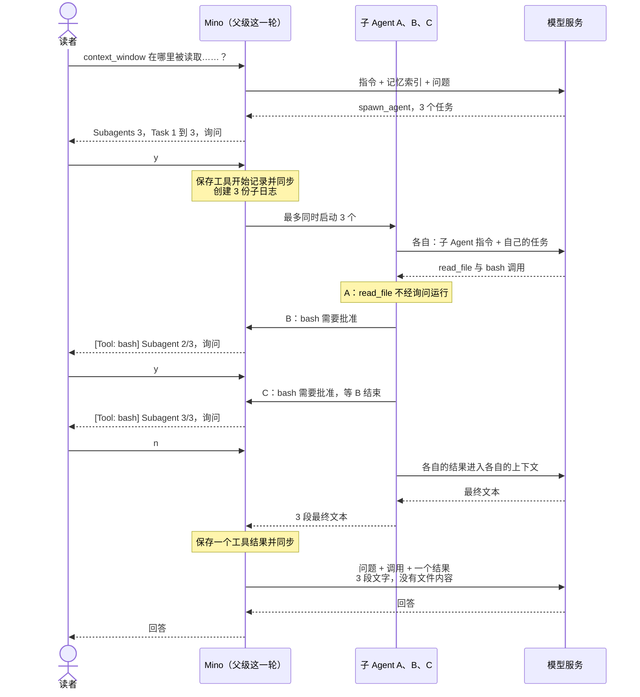

# 第 14 章：把工作委派给子 Agent

适用版本：**0.14.x** · 源码与发布标签：**[chapter-14](https://github.com/qshine/mino/tree/chapter-14)** · 程序版本：**0.14.0**，发布于 **2026-10-28**

就一个你不太熟悉的项目问 Mino 三件事：`context_window` 设置在哪里被读取，它的默认值怎样计算，又有哪些测试覆盖它。在第 13 章，模型会在一轮问答里把三件事都做完。它用 `read_file` 打开的每个文件、`grep` 输出的每一页，都会留在对话里，而回答也许只需要其中十几行。[第 06 章](./06-context-compaction.md)的压缩帮不上忙：它从不摘要进行中的这一轮和此前最近的两轮。而且一轮最多只能调用 16 次工具，一次大范围搜索可能还没找到东西就把它用完了。

本章让模型把这类工作交给**子 Agent**。新工具 `spawn_agent` 接收一批最多十个任务。Mino 把每个任务作为一个独立的子 Agent 运行，它有自己的上下文、自己的会话日志和自己的上限；最后只把它们的最终文本作为一个工具结果交还给父级。子 Agent 读过的文件从不进入父级的上下文。更难的部分是权限：每个子 Agent 都用你的工具在你的项目里行动，所以本章讲“谁批准什么”，和讲并行一样多。构建这个版本的方法见[第 14 章准备说明](../getting-started.md#从源码体验第十四章)。

## 1. 三个问题，一次委派

交互示意。问题、任务文本、会话 ID、命令以及模型的措辞都是示例；确认界面的字段标签、警告、`[subagent N/M]` 状态行和结果的版式与当前源码一致。会话处于 `manual` 模式，部分字段值缩写为 `...`。

```text
You> context_window 在哪里被读取，默认值怎么算，有哪些测试覆盖它？

Assistant>
[Tool: spawn_agent]
Subagents: "3"
Task 1: "在这个 Go 项目中找出读取、校验或为 context_window 设置默认值的所有位置。只用 read_file。报告文件路径和函数。"
Task 2: "找出默认上下文窗口和压缩阈值是怎样计算的。先用 grep 搜索，再报告相关常量、计算公式和文件路径。"
Task 3: "找出覆盖 context_window 的测试并用 go test 运行它们。报告测试名称以及是否通过。"
Each subagent works in its own context with this session's permission mode; its tool calls that need approval will ask one at a time.
Approve this operation? [y/N] y
[subagent 1/3] read_file: completed
[subagent 3/3] read_file: completed

[Tool: bash]
Subagent: "2/3: 找出默认上下文窗口和压缩阈值是怎样计算的。先用 grep 搜索，再报告相关常量、计算公式和文件路径。"
Command: "grep -rn ContextWindow internal"
Working directory: "/path/to/mino"
Environment: "..."
Limits: "Timeout: 30s; combined output limit: 65536 bytes."
Sandbox: "on: writes only inside /path/to/mino, temporary and cache directories; protected paths and ~/.mino blocked; no network."
The kernel confines this command's writes and network; it still reads what your account can read, except protected files.
Approve this operation? [y/N] y
[subagent 2/3] bash: completed

[Tool: bash]
Subagent: "3/3: 找出覆盖 context_window 的测试并用 go test 运行它们。报告测试名称以及是否通过。"
Command: "go test ./internal/... -run Context"
...
Approve this operation? [y/N] n
[subagent 3/3] bash: denied
[subagent 1/3] read_file: completed
[subagent 1/3] read_file: completed
[subagent 2/3] read_file: completed

[Tool result: completed]
Subagent results: 3 tasks, 3 completed, 0 failed, 0 cancelled.

[1/3] completed · session 5d0e2a7c9b1f4e6a8c3d5b7f9a1e2c4d · 4 requests, 3 tool calls
context_window 在 internal/config.go 中解析和校验，在 internal/app.go 中传给 Agent，值为 0 时由 internal/agent/agent.go 换成默认值。

[2/3] completed · session 8b4f1c6e2a9d7b3f5e1c8a4d6b2f9e7a · 3 requests, 2 tool calls
DefaultContextWindow 为 128000（internal/agent/agent.go）。internal/agent/compact.go 为输出预留 min(8192, window/8) 个 token，其余是输入预算。

[3/3] completed · session 2e7a9c4b6d1f3e8a5c2b7d9f4a6e1c3b · 3 requests, 2 tool calls
internal/config_context_test.go 测试这个字段的校验，internal/agent 中的 compact_*_test.go 测试预算。go test 命令未获批准，所以测试没有运行。

Assistant> context_window 在 internal/config.go 中读取，默认 128,000 tokens……相关测试存在，但本次会话没有运行它们。
```

数一数你被问了几次。批准 `spawn_agent` 是一个问题，而它并没有批准子 Agent 将要做的任何事。子 Agent 1 只读文件，读取从不询问。子 Agent 2 的 `grep` 和子 Agent 3 的 `go test` 各自单独询问，每个问题的第一行都是 `Subagent`，写明它来自哪个任务。子 Agent 3 的问题要等你答完子 Agent 2 的问题才出现。你拒绝了它，而子 Agent 3 并没有失败：它的模型看到了这次拒绝，并报告测试没有运行。

模型写出哪些任务、每个子 Agent 用哪些工具、回答怎样措辞，都取决于模型。程序保证的是其余部分：询问本身、问题出现的顺序、结果的版式，以及父级的下一次请求带的是这三段简短文字，而不是它们背后的文件。

## 2. 双方各自看到什么

### 2.1 子 Agent 收到什么

子 Agent 不从父级说过的任何话开始。它唯一的一条用户消息就是它的任务，所以工具描述和默认 `SOUL.md` 都要求模型把每个任务写成一条完整的指令。请求的其余部分取自父级已有的内容。

表 14-1：子 Agent 与父级这一轮共享什么，又各自拥有什么。

| | 父级这一轮 | 每个子 Agent |
| --- | --- | --- |
| 指令 | 你的 `SOUL.md` 和会话的技能目录 | 同一份 `SOUL.md`，接着一段固定的子 Agent 说明，再接同一份目录 |
| 第一条用户消息 | 你的问题 | 它的任务文本 |
| 对话历史 | 会话日志 | 没有：一份自己的新日志 |
| 记忆索引 | 在这一轮开始时渲染 | 同一份索引，从不重新扫描 |
| 工具 | 所有已配置的工具 | 同样的工具，但没有 `spawn_agent` 和 `memory_save` |
| 权限模式 | 会话的模式 | 同一个模式，由同一个策略检查 |
| 上限 | 每轮 8 次请求、16 次工具调用 | 自己的 8 次请求、16 次工具调用 |
| 模型设置 | `model`、`base_url`、`api_key`、`context_window` | 相同，并有自己的压缩 |

那段固定说明告诉模型：它是一个子 Agent；它看不到另一边的对话，也不能向你提问；其他子 Agent 可能同时在同一个项目里工作；它的最终消息会作为它的全部结果返回，长度不能超过给定的字节数。三个任务时，这个数是 16,384。

技能目录的来源和[第 07 章](./07-skills.md)为父级冻结它的方式一致：子 Agent 的日志以父级 `session_skills` 记录的一份副本开头，而不是重新扫描，所以父级和子 Agent 对有哪些技能的认识一致，`skill_view` 在两边都能用。记忆索引就是父级在这一轮开始时渲染的那一份，和[第 13 章](./13-user-memory.md)一样；`memory_view` 仍然可用，但没有哪个子 Agent 会再扫描 `~/.mino/memory`，也不会重复关于坏文件的提示。

### 2.2 返回给父级的是什么

子 Agent 工作时，它自己的文字不会显示。三段回答同时流进一个终端会无法阅读，而最终文本反正会出现在工具结果里。子 Agent 内的每个工具结果变成一行状态，例如 `[subagent 2/3] bash: completed`；子 Agent 发出的任何提示，例如它自己的压缩提示，也带同样的前缀。

所有子 Agent 都结束后，Mino 构建一个工具结果。第一行统计各种结果的数量。接着每个任务按你看到任务的顺序（而不是完成的顺序）得到一行标题：它的状态、会话 ID、用了多少次请求和工具调用，后面是它最后的回答文本。提前停止的子 Agent 状态为 `failed`，并附上截到 256 字节的原因，例如请求或工具调用用完时是 `[2/3] failed: Tool limit reached.`，模型服务拒绝请求时则是那条错误文本。一个失败不会让其他子 Agent 停下。

这些文本共享 48 KiB 的预算，平均分配：三个任务时每个 16 KiB，十个任务时每个约 4.8 KiB。更长的文本会在字符边界处截断，并标上 `[truncated N bytes]`。平均分配意味着一个啰嗦的子 Agent 挤不掉其他子 Agent，整个结果也总能放进第 03 章那 64 KiB 的工具输出上限之内。

只有每个任务都完成时，结果的状态才是 `completed`。如果你在这一批运行时按下 Ctrl+C，Mino 会取消各个子 Agent，把结果记为 `cancelled`，其中每个未完成的任务都标为 `cancelled`，然后退出，和第 03 章以来任何工具调用期间按 Ctrl+C 的效果一样。其他情况下状态为 `failed`，但每一段仍然都在，模型可以用上已经完成的那些任务。

父级的下一次请求包含的就是这个结果，它和 `spawn_agent` 调用配对，与其他任何结果一样。子 Agent 1 读过的三个文件、`grep` 的输出、子 Agent 3 被拒绝的命令，都留在各个子 Agent 的日志里。

## 3. 一次调用，多个循环



图 14-1：父级这一轮只发两次请求，中间是一次调用和一个结果。子 Agent 读取和运行的一切都发生在这次调用内部，在它们自己的上下文和日志里。

在窄屏上可以横向滚动图表。调用内部的顺序很重要。Mino 检查参数和每轮上限，询问你，然后保存 `spawn_agent` 的开始记录，和[第 03 章](./03-tools-and-bash.md)以来的每个工具一样。之后它才创建每个子 Agent 的日志，而且是在任何子 Agent 运行之前全部创建，再通过一个小池子启动它们：默认同时最多三个，所以十个任务时，前三个中有一个结束，第四个才开始。父级等它们全部完成，在下一次请求之前保存那唯一的结果。

### 3.1 为什么这一批在一次工具调用里运行

最直接的并行方式，是让模型在一个响应里请求多个工具调用，再同时运行它们。Mino 没有这样做。从[第 04 章](./04-recovering-tool-turns.md)起，父级的历史是一个严格的序列：每个调用先开始、再得到结果，按模型请求的顺序排列；正是这个顺序让重启时能判断哪个调用可能已经运行却没有保存结果。让开始和结果交错，就需要新的记录格式，更早的版本也将无法读取这些会话。

把并行放进一次调用内部，父级的历史就和以前完全一样：每个调用一条 `tool_start`、一条 `tool_result`，记录版本 4，没有新的记录类型。子 Agent 自己的记录进入它们自己的日志，每一份都是普通的顺序会话。

代价是父级要等最慢的那个子 Agent。其他子 Agent 还在运行时，模型无法先根据第一个结果行动；一个要跑整整一分钟的任务，会让整批等上这一分钟。模型仍然可以在同一轮的后续步骤里再次调用 `spawn_agent`，所以这条边界以批为单位，而不是以轮为单位。

### 3.2 一批的上限

委派会成倍增加请求，所以每个维度都有上限：

- **每次调用：**1 到 10 个任务，每个是非空的 UTF-8 字符串，最多 8 KiB，合计最多 32 KiB。参数解析很严格：重复或未知的键都会得到 `invalid_arguments`。
- **每一轮：**最多 16 个子 Agent。会超过这个数的一批在询问你之前就被 `denied`，结果会告诉模型它已经启动了多少个。所以先来一批 10 个、再来一批 7 个，你只会被问一次，而不是两次。
- **每个子 Agent：**自己的 8 次请求和 16 次工具调用，所以一轮在父级自己的 8 次请求之外，最多再花 16 × 8 次子 Agent 请求。
- **同时运行：**默认 3 个，或 `~/.mino/config.json` 中的 `max_concurrent_subagents`，取 1 到 10。Mino 从不询问这个字段，见[准备说明](../getting-started.md#配置子-agent-并发数)。

没有自动重试；从[第 01 章](./01-terminal-chat.md)起，Mino 就从不重试失败的请求。模型服务返回的限流错误会让那一个任务以该错误为原因失败；如果你的服务商限制并发请求数，请调低 `max_concurrent_subagents`。

终端不显示 token 用量，子 Agent 的也不例外。[`mino eval`](./11-evals.md) 会把它们计入 token 总数，所以一个包含委派的用例报告的是整批的花费。

### 3.3 子日志、崩溃与 `/clear`

每个子 Agent 的日志是 `~/.mino/sessions/<session-id>.agents/<child-id>.jsonl`，其中 `<child-id>` 是 Mino 新生成的随机 ID，从不使用模型的调用 ID。目录以权限 `0700` 创建，文件为 `0600`，与[第 05 章](./05-jsonl-sessions.md)的会话日志一致。每段结果标题里的 ID 就是这个文件的名称，所以你可以打开子 Agent 的日志，准确看到它读了什么、运行了什么。

这些日志只是记录。`/sessions` 只列出顶层的 `<id>.jsonl` 文件，所以子 Agent 从不出现在那里，`/resume` 也选不中它们。如果 Mino 在一批运行时被强行终止，父级日志会以 `spawn_agent` 的开始记录结尾，没有结果。重启时这就是第 04 章的普通情况：调用被记为 `unknown`，聊天继续之前需要你确认。子日志保持原样；Mino 从不修复、重新打开它们，也不重新运行它们的任务。

`/clear` 现在会连同会话历史一起删除 `<session-id>.agents/`，它的确认提示也写明了这一点：`Clear this session's saved history, including its subagent logs?`。

如果某个子 Agent 无法写入日志，Mino 会取消其他子 Agent 并停止聊天，和父级自己的历史无法保存时一样：记录可能不完整的一批，不值得在它上面继续。

## 4. 批准不会向下传递

### 4.1 一次只问一个问题

子 Agent 需要询问的事情和父级一样。它的调用经过[第 10 章](./10-guardrails.md)的那个决定，使用的是会话自己的策略，所以你选择的模式在每个子 Agent 里都生效。`spawn_agent` 本身不是只读的，没有指向项目文件的目标，也不在沙箱中运行，所以在 `manual` 和 `accept-edits` 下落到询问。

表 14-2：委派本身以及子 Agent 所发调用在各模式下的决定。

| 调用 | `manual` | `accept-edits` | `bypass` |
| --- | --- | --- | --- |
| `spawn_agent` | 询问 | 询问 | 运行，并显示 |
| 子 Agent 的 `read_file`、`skill_view`、`memory_view` | 运行，不询问 | 运行，不询问 | 运行，不询问 |
| 子 Agent 在沙箱内的 `bash`、`write_file`、`edit_file` | 询问 | 运行，并显示 | 运行，并显示 |
| 子 Agent 带 `sandbox: false` 的 `bash`、`mcp_` 工具 | 询问 | 询问 | 运行，并显示 |
| 一轮中超过 16 个子 Agent 的一批 | 拒绝 | 拒绝 | 拒绝 |

开头的场景如果在 `accept-edits` 下，两个 Bash 问题会消失：如[第 12 章](./12-sandbox.md)所述，沙箱内的 Bash 在这个模式下不经询问运行；每次调用连同所有字段一起显示，每一行都带着它的 `[subagent N/M]` 前缀。`spawn_agent` 的问题仍然保留。

Mino 目前不允许用一次批准覆盖子 Agent 的调用。另一种做法是“批准这一批及其中的一切”，它会把一个关于几段任务文本的问题，变成对尚未有人写出的命令的同意。当前选择的代价是问题更多，这也是 `accept-edits` 和沙箱在本章比之前任何一章都更重要的原因。

子 Agent 同时运行，但终端只有一个。同一批的所有子 Agent 共用一道闸门：一个子 Agent 需要询问时，会等到没有其他问题打开；它的问题打开期间，其他子 Agent 不会被停止，但每一个都会在下一行状态或下一个完成的响应处等待，直到问题关闭。每个问题会多出第一个字段 `Subagent`，写明子 Agent 的序号和它任务的第一行（截到 60 个字符），这样三个相似的 `grep` 命令摆在面前时，你也知道自己批准的是哪一个。

### 4.2 沙箱现在封住 `~/.mino`

在第 12 章的沙箱配置下，受限命令可以读取受保护模式之外的任何文件。这包括 `~/.mino`：存着 API Key 的 `config.json`、每一份会话日志和每一条记忆。在 `accept-edits` 下，这样的命令不经询问运行；有了子 Agent，几条这样的命令可能同时运行，而你看到的只是一行行状态。

现在，配置同时拒绝读取和写入 `~/.mino`；如果 `~/.mino` 是符号链接，它背后的真实目录也一并拒绝。这适用于 Bash，以及用 `--sandbox` 添加的 stdio MCP 服务。确认界面的 `Sandbox` 一行写明了这一点：`protected paths and ~/.mino blocked`。Mino 对每条受限命令都这样做，而不只是子 Agent 的命令，因为一条不经询问运行的命令不应该能读到你的 Key。普通命令用不到这个目录，而 Mino 自己的工具（例如 `memory_view`）读取它时不经过 Bash。

代价是 `cat ~/.mino/memory/uses-pnpm.md` 现在在沙箱里会以 `Operation not permitted` 失败。边界就是沙箱本身：你以 `sandbox: false` 批准的命令，或没有 `sandbox-exec` 的系统上的任何命令，仍然可以读取这个目录。

### 4.3 子 Agent 在哪里止步

- **只有一层。**子 Agent 拿不到 `spawn_agent`，所以子 Agent 不能再启动自己的子 Agent。
- **不写记忆。**子 Agent 拿不到 `memory_save`。只有你参与其中的父级对话才能提出保存一条记忆。
- **不能向你提问。**子 Agent 看不到你的对话，也不能请你澄清；不清楚的任务只会换来不清楚的回答。
- **子 Agent 之间没有协调。**它们共享同一个项目目录，Mino 不在它们之间给文件加锁。工具描述要求模型不要让并行任务改动同一批文件；程序不做检查。
- **父级看到的是结论，不是证据。**它收到每个子 Agent 的最终文本，只能相信它，或打开子 Agent 的日志，或再委派一次核查。
- **本章不包括：**自定义子 Agent 定义、调用返回后仍继续运行的后台子 Agent，以及一次批准某一批所做一切的授权。

## 5. 用评测和测试检查它

两份新用例让 `scripts/check.sh` 中的回放用例集增加到十三份。回放时子 Agent 总是逐个运行：脚本化模型按到达顺序回答请求，先是父级的请求，然后是子 Agent 1 的全部请求，再是子 Agent 2 的，最后是父级的最后一次请求；并发的子 Agent 会让这个顺序无法预测。实时运行使用你配置的并发数。

- `subagent-batch` 委派两个任务，每个都在自己的子 Agent 里用 `read_file` 读取一个文件。评分器要求 `spawn_agent` 完成、`read_file` **没有**被调用，并且最多两次请求。评分器只读取父级的会话日志，所以那里没有 `read_file`，就是读取留在子 Agent 里的证据。它标为 `live: false`，因为它断言的是真实模型未必会走的路径。
- `subagent-approval` 只批准 `spawn_agent`。因此子 Agent 的 `rm -rf build` 被拒绝，子 Agent 报告了这一点，评分器检查 `build/out.txt` 仍然存在。

```bash
go build -o bin/mino ./cmd/mino
bin/mino eval ./evals
```

交互示意：在有 `sandbox-exec` 的 macOS 上，十三行全部通过；在没有沙箱的地方，第 12 章的三份 `sandbox-*` 用例仍会失败。

Go 测试不需要 API Key：

```bash
go test ./internal/agent -run 'Subagent|Spawn'
go test ./internal/sandbox -run TestMinoDataDirectoryIsBlocked
go test ./internal -run TestMaxConcurrentSubagentsConfiguration
```

[`TestSubagentsRunInParallelAndReturnOneResult`](https://github.com/qshine/mino/blob/chapter-14/internal/agent/subagent_test.go) 沿着图 14-1 走。它的模拟模型服务会扣住每个子 Agent 的第一次请求，直到三个请求同时在途，而这只有在它们真正同时运行时才会发生。接着它检查每个子 Agent 收到的内容（开头是 SOUL 文本、字节预算、技能目录、记忆索引，以及包含 `memory_view` 和 `skill_view`、但不含 `spawn_agent` 和 `memory_save` 的工具列表），检查你只被问了一次，结果按顺序列出三个任务，没有任何子 Agent 的文字被流式显示，父级日志里恰好有一条工具开始记录和一条工具结果，同时存在三份子日志。

相邻的测试检查：问题从不重叠，并带有 `Subagent` 字段，而 `bypass` 什么都不问、只打印带前缀的行；先 10 个、再 7 个任务时，第二批在第二次询问之前就被拒绝；取消这一轮会取消整批，并记录 `cancelled` 结果；子 Agent 的存储失败会停止聊天；一批运行时的崩溃在重启后成为 `unknown`，且不会重新运行子 Agent；`/sessions` 忽略子日志，`/clear` 删除它们；参数有上限；十段长文本共享预算并保持合法的 UTF-8。沙箱测试在配置下读取、列出和写入一个伪造的 `~/.mino`，并要求三者都失败。

这些检查确立的是程序询问了什么、发送了什么、记录了什么、返回了什么。它们不能确立真实模型会写出自成一体的任务、在该委派时委派，或如实总结它的发现。

## 6. 本章小结与下一步

回到关于 `context_window` 的三个问题。在第 13 章，搜索打开的每个文件都会留在对话里。现在，父级这一轮只有一次调用和一个由三段简短文字组成的结果，文件留在三份你可以打开的子日志里。每个子 Agent 都在会话的权限模式下工作，它的问题带着标签逐个来到你面前，而批准委派只批准委派本身。限制同样明确：只有一层，不写记忆，每轮最多 16 个子 Agent，父级要等最慢的那个。

到目前为止，每个子 Agent 都是同一种通用助手：你的 SOUL、除两个以外的所有工具，以及模型每次写进任务里的角色。一个想要专职审查者、或者一个根本不能运行 Bash 的只读探索者的项目，还没有办法把这些说出来。[第 15 章：为子 Agent 定义项目角色](./15-custom-subagents.md)加入 `.agents/agents/<name>.md` 中的定义，用来命名一个角色、说明何时使用它，并可以缩小它的工具范围；这个范围由程序强制执行，而不是靠任务文本。[章节规划](../plan-todo-chapters.md)记录了每一章的状态。
